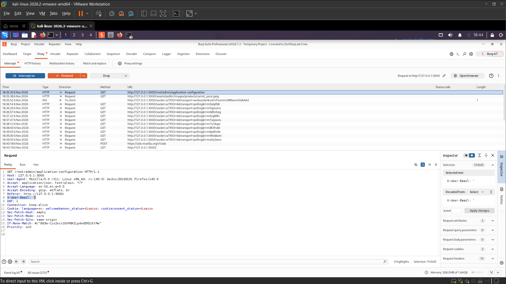
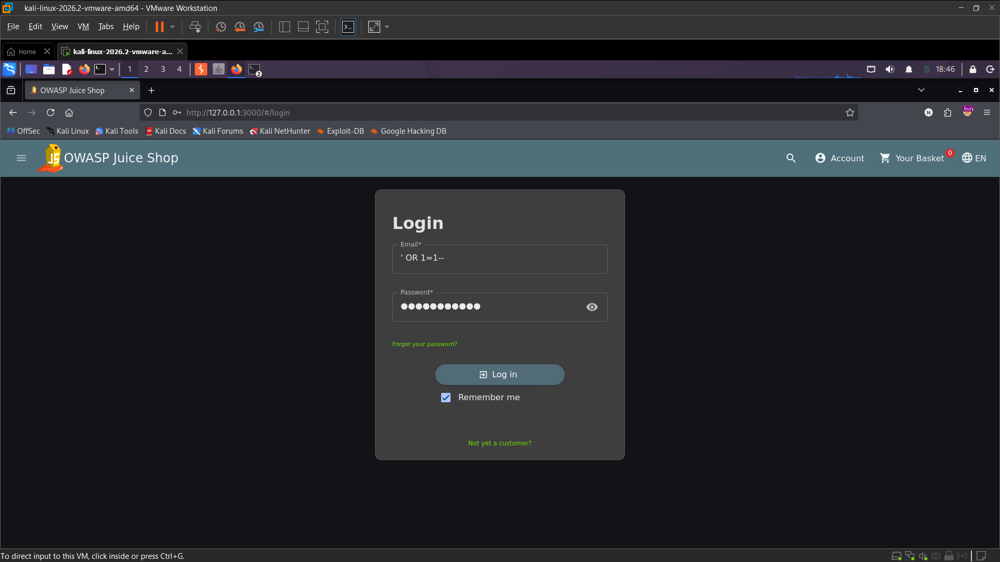
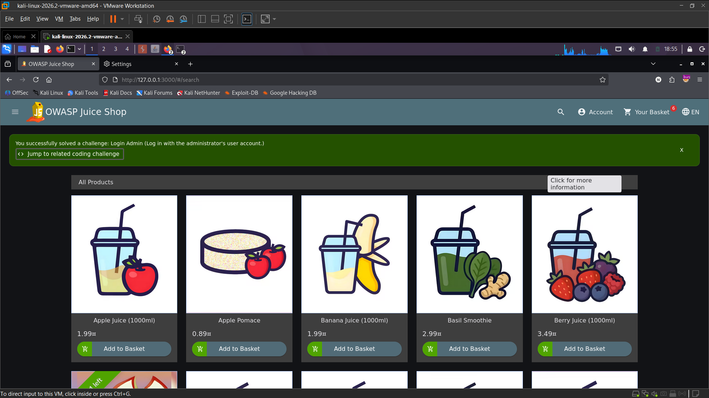
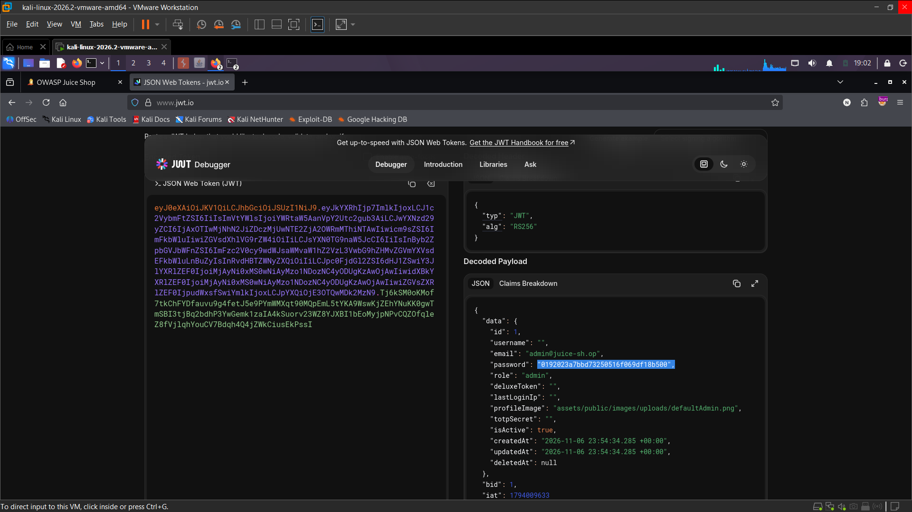
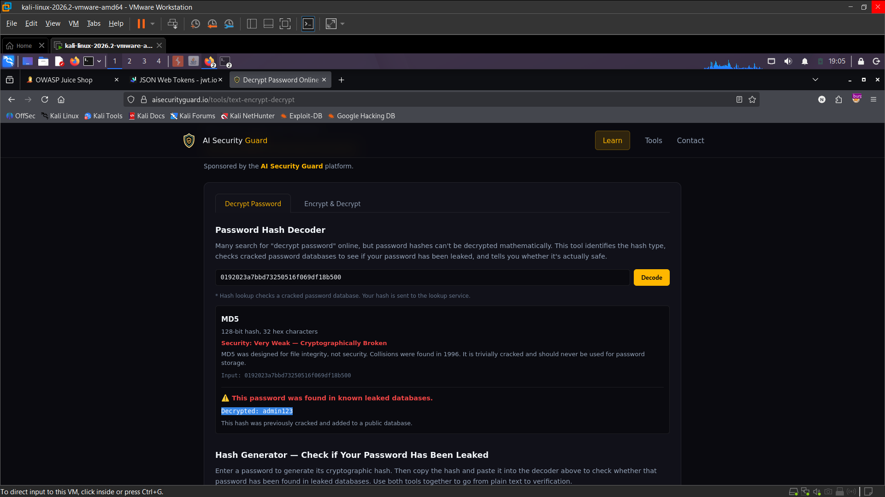

# OWASP Juice Shop – Admin Account Compromise via Credential Exposure (Sensitive Data Exposure)

> Tested on a local, intentionally vulnerable training app (OWASP Juice Shop) at `http://127.0.0.1:3000`.
> Date: 2026-11-11 | Tools: Burp Suite, Firefox, JWT.io, password hash lookup tool

## Summary

The screenshots document an admin-account compromise chain in the local OWASP Juice Shop: an admin login was obtained, the issued JWT was inspected in browser storage, and its decoded claims exposed the administrator account's password hash. The hash was cracked offline and the recovered credentials were used to authenticate as the administrator. The captured evidence does not include a complete login request/response, so the exact authentication endpoint and the initial access method cannot be confirmed from the screenshots alone.

| Field | Value |
|---|---|
| Vulnerability | Sensitive Credential Exposure in JWT (JWT credential disclosure) |
| Category | OWASP Top 10 – A02:2021 Cryptographic Failures |
| Endpoint | Not specified in the screenshots (JWT is shown in browser Local Storage) |
| Authentication | Required to obtain the shown admin JWT; initial authentication details not fully captured |
| Impact | Confidentiality and integrity: disclosure of a crackable admin password hash enabled administrator account access |
| Challenge solved | **Password Strength** (Log in with the administrator's user credentials without previously changing them or applying SQL Injection.) |

## Test Accounts

| Role | Email | User ID | Account ID | Account content |
|---|---|---|---|---|
| Attacker | Not specified | Not specified | N/A | Tester-controlled browser session |
| Victim / Administrator | admin@juice-sh.op | 1 | 1 | Administrator account; password hash was present in the decoded JWT claims |

## Steps to Reproduce

### 1. Reach the administrator account

The login page shows an authentication attempt using the value `' OR 1=1--` in the email field. A separate Burp screenshot shows a request to `/rest/admin/application-configuration`, but it does not show the login request or its response. The exact relationship between these two requests is therefore not established by the captured evidence.




### 2. Confirm administrator access

The application reports that the **Login Admin** challenge was solved. This confirms admin access, but the screenshot does not show the corresponding HTTP response.



### 3. Inspect the JWT stored by the application

Browser Local Storage contains a JWT. The decoded payload identifies the administrator account and includes its password hash. The raw token and hash are visible in the supplied screenshots; they are not repeated in this report.




### 4. Recover the password from the exposed hash

The supplied hash lookup screenshot shows that the hash was recognized as MD5 and returned a password. The recovered password is intentionally omitted from this report, but remains visible in the original evidence image.

```http
Not captured: the screenshots do not include the login HTTP request/response used after recovering the password.
```

The hash lookup result supports the offline password recovery step:



### 5. Result

The application reports that **Password Strength** was solved after logging in with the administrator's credentials. This confirms successful use of the recovered credentials.


## Root Cause

The JWT payload contains a password hash for the administrator account. Password hashes are authentication secrets and should not be included in client-readable token claims. The displayed MD5 hash is also unsuitable for password storage because it is fast to crack offline.

## Impact

A user who can obtain the affected JWT can inspect its claims and take the password hash offline for cracking. If the password is recovered, the attacker can authenticate as the administrator and gain the privileges available to that account. The screenshots demonstrate impact against the local training instance only.

## Remediation

- Remove password hashes and all other authentication secrets from JWT claims and API responses.
- Store passwords using a salted, deliberately slow password hashing function such as Argon2id, scrypt, or bcrypt.
- Rotate the administrator password and invalidate existing tokens after removing the sensitive claim.
- Restrict JWT claims to the minimum identity and authorization data required by the client; enforce authorization on the server.

## References

- OWASP Top 10 – A02:2021 Cryptographic Failures
- OWASP API Security Top 10 – API3:2023 Broken Object Property Level Authorization
- OWASP Juice Shop – https://owasp.org/www-project-juice-shop/

## Disclaimer

For educational purposes only, performed on a local lab environment.
