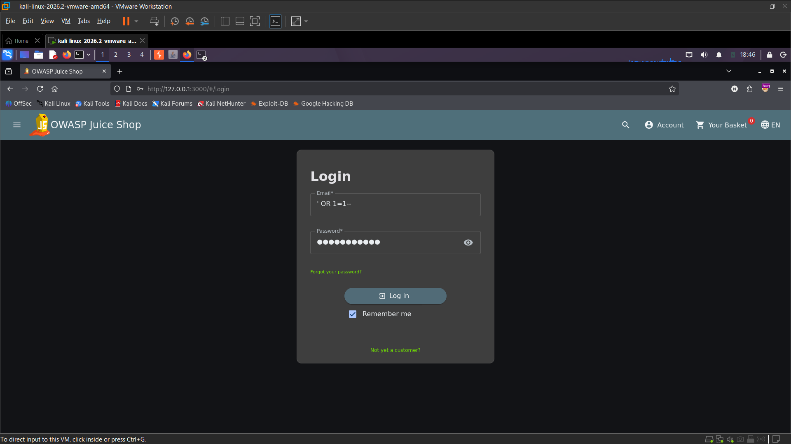
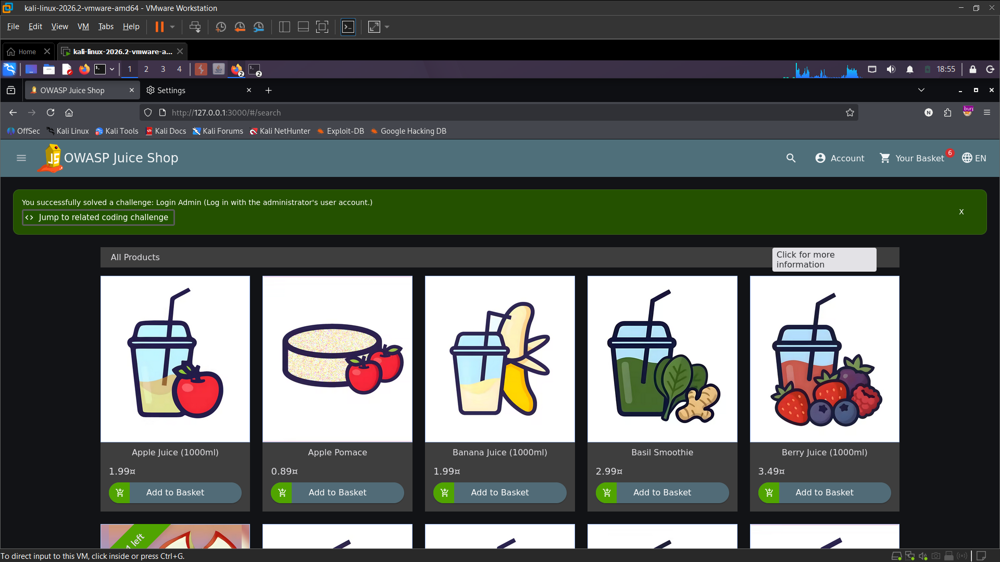
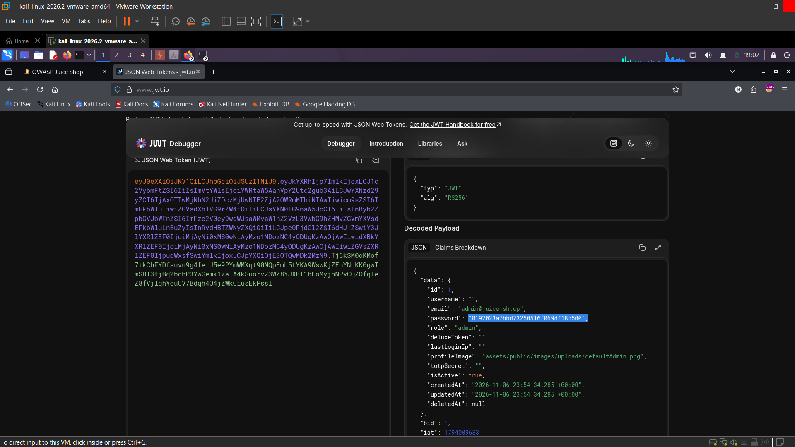
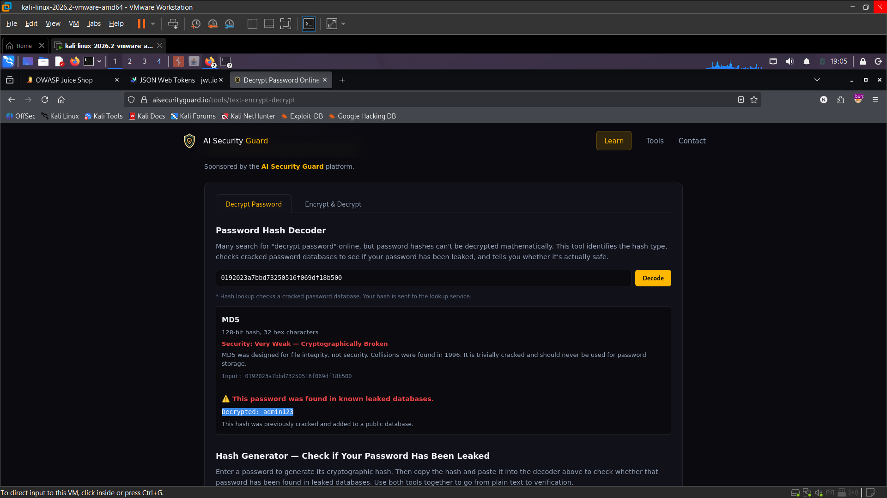

# OWASP Juice Shop – Administrator Account Compromise via SQL Injection and Credential Exposure (SQL Injection, Sensitive Data Exposure)

> Tested on a local, intentionally vulnerable training app (OWASP Juice Shop) at `http://127.0.0.1:3000`.
> Date: 2026-11-06 | Tools: Firefox, JWT.io, password hash lookup tool

## Summary

The screenshots show one administrator compromise chain: an SQL-style value is submitted in the login form, the Login Admin challenge is solved, the resulting JWT exposes the administrator password hash, the hash is identified as MD5 and recovered offline, and the Password Strength challenge is solved. The login HTTP request and token issuance endpoint are not captured.

| Field | Value |
|---|---|
| Vulnerability | Administrator Account Compromise via SQL Injection and Credential Exposure |
| Category | OWASP Top 10 – A03:2021 Injection; A02:2021 Cryptographic Failures |
| Endpoint | Login API and token issuance endpoint not specified in the screenshots |
| Authentication | No prior authentication is shown; the chain obtains administrator access |
| Impact | Confidentiality and integrity: administrator account access was demonstrated in the local lab |
| Challenge solved | **Login Admin and Password Strength** (administrator access and use of recovered credentials) |

## Test Accounts

| Role | Email | User ID | Account ID | Account content |
|---|---|---|---|---|
| Attacker | Not specified | Not specified | N/A | Tester-controlled browser session |
| Victim / Administrator | admin@juice-sh.op | 1 | 1 | Administrator account; JWT contains a password hash |

## Steps to Reproduce

### 1. Submit the login value

The login form shows an SQL-style value in the email field. The password is masked in this screenshot.



### 2. Confirm administrator access

The application reports that the Login Admin challenge was solved.



### 3. Inspect the JWT and decoded claims

Browser Local Storage contains a JWT. The decoded payload identifies the administrator and includes a password hash. The values are visible in the supplied training-lab evidence.




### 4. Recover the password from the exposed hash

The lookup screenshot identifies the hash as MD5 and shows the recovered password.



The exact login HTTP request and response are not captured:

```http
Not captured in the supplied screenshots.
```

### 5. Result

The application reports that Password Strength was solved after the administrator credentials were used.


## Root Cause

The evidence shows an authentication bypass consistent with SQL injection, followed by a JWT that includes a password hash. The hash uses MD5, allowing offline password recovery. The login request is not captured, so the exact query and vulnerable parameter remain unspecified.

## Impact

A user able to submit the demonstrated login value can obtain administrator access in the local lab. The JWT also exposes a crackable password hash, which enables offline recovery and reuse of administrator credentials. The evidence establishes impact only against this training instance.

## Remediation

- Use parameterized queries for login inputs.
- Never include password hashes or other secrets in JWT claims or API responses.
- Store passwords using a salted, deliberately slow hash such as Argon2id, scrypt, or bcrypt.
- Rotate the administrator password and invalidate existing tokens after remediation.

## References

- OWASP Top 10 – A03:2021 Injection; A02:2021 Cryptographic Failures
- OWASP API Security Top 10 – API3:2023 Broken Object Property Level Authorization (sensitive property exposure)
- OWASP SQL Injection Prevention Cheat Sheet – https://cheatsheetseries.owasp.org/cheatsheets/SQL_Injection_Prevention_Cheat_Sheet.html

## Disclaimer

For educational purposes only, performed on a local lab environment.
