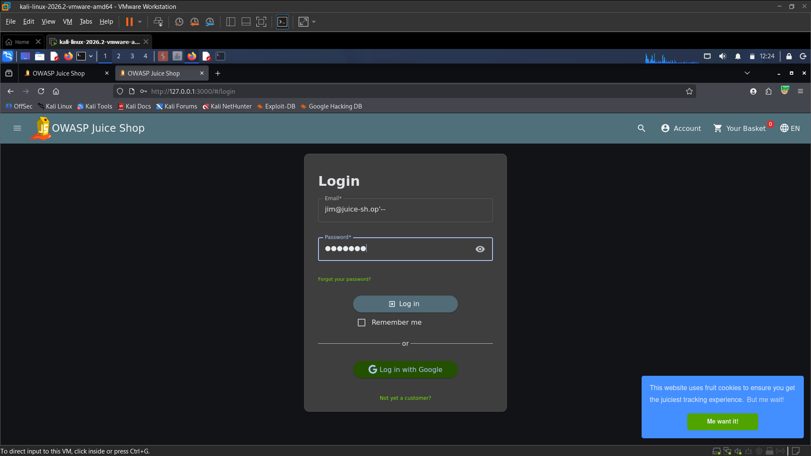
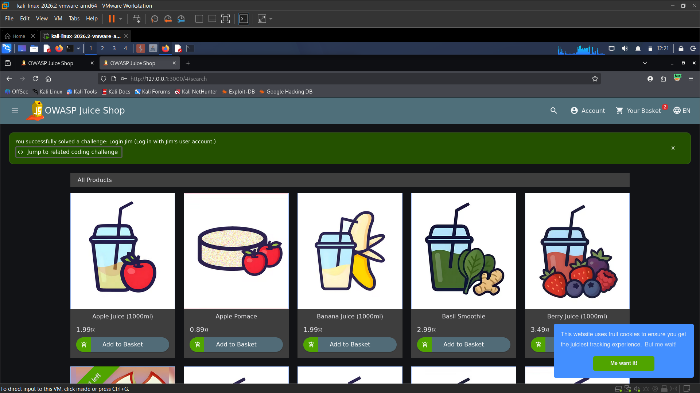

# OWASP Juice Shop – SQL Injection Authentication Bypass – Login Jim (SQL Injection)

> Tested on a local, intentionally vulnerable training app (OWASP Juice Shop) at http://127.0.0.1:3000.
> Date: Not specified in the screenshots | Tools: Firefox, Burp Suite, sqlmap where shown

## Summary

The login page shows an email value with a quote and SQL comment marker, then reports Login Jim solved. No HTTP request or response is captured, so endpoint and behavior are unconfirmed.

| Field | Value |
|---|---|
| Vulnerability | SQL Injection Authentication Bypass (SQLi) |
| Category | OWASP Top 10 – A03:2021 Injection |
| Endpoint | Not specified (UI shows /#/login) |
| Authentication | Not specified; login page shown before authentication |
| Impact | Confidentiality and integrity: Jim account access was demonstrated in the local lab. |
| Challenge solved | **Login Jim (log in with Jim’s user account)** |

## Test Accounts

| Role | Email | User ID | Resource ID | Resource content |
|---|---|---|---|---|
| Victim | jim@juice-sh.op | Not specified | N/A | Jim account access confirmed by challenge banner. |

## Steps to Reproduce

### 1. Enter the login value

The email field shows jim@juice-sh.op'--; the password is masked.



### 2. Observe the result

The app reports Login Jim solved.



### 3. Assess the suspected injection

The quote and comment marker are consistent with SQL injection. No baseline or raw request/response was supplied.

### 4. Exploit request

The exact HTTP request, parameter, and response are not captured.

```http
Not captured.
```

### 5. Result

The challenge banner confirms Jim account access in the local lab.

## Root Cause

Login input may be concatenated into SQL without parameterization. This remains suspected because request/response evidence is missing.

## Impact

Confidentiality and integrity: Jim account access was demonstrated in the local lab.

## Remediation

- Use parameterized queries for all dynamic values.
- Validate and allow-list inputs where appropriate.
- Apply least-privilege database access.
- Avoid exposing internal data or distinguishable database errors.

## References

- OWASP Top 10 – A03:2021 Injection
- OWASP API Security Top 10 – Not specified for this finding.
- OWASP SQL Injection Prevention Cheat Sheet – https://cheatsheetseries.owasp.org/cheatsheets/SQL_Injection_Prevention_Cheat_Sheet.html

## Disclaimer

For educational purposes only, performed on a local lab environment.

