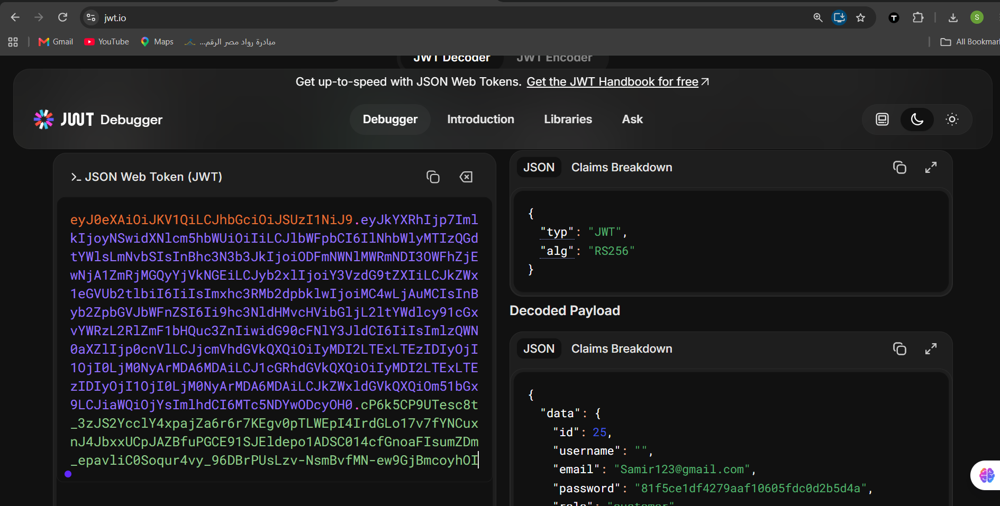
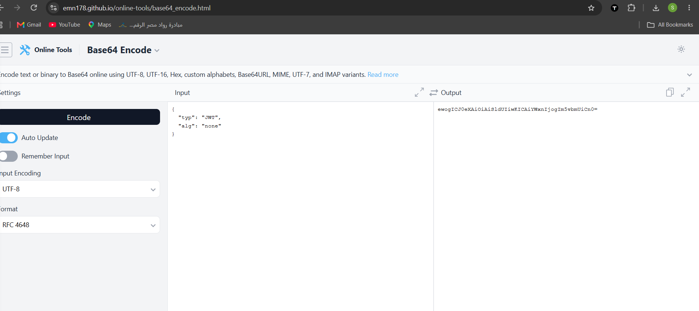
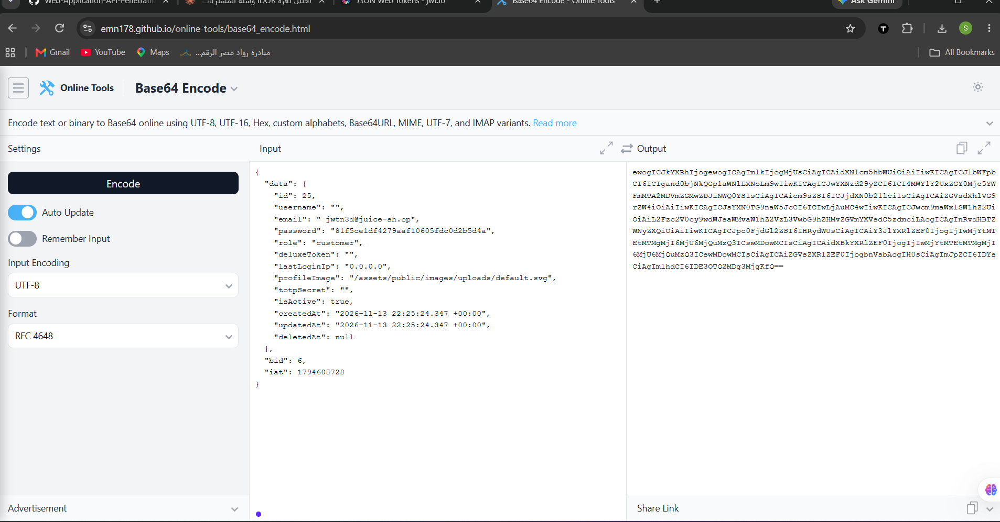
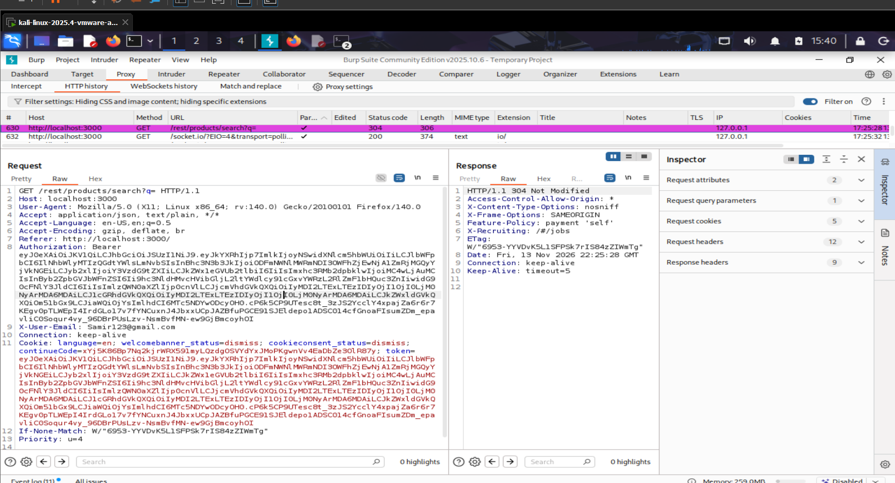
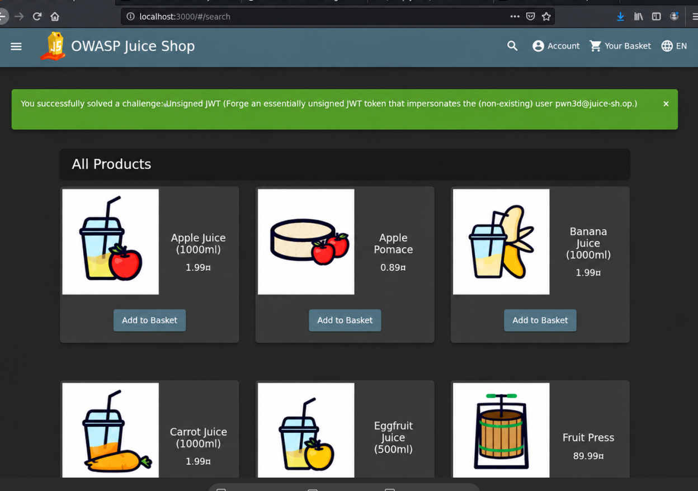

# OWASP Juice Shop – Unsigned JWT (JWT signature validation / `alg: none`)

> Tested on a local, intentionally vulnerable training app (OWASP Juice Shop) at `http://localhost:3000`.
> Date: 2026-11-17 | Tools: Burp Suite, JWT Debugger (jwt.io), Base64 Encoder, browser

## Summary

The Juice Shop displayed a successful **Unsigned JWT** challenge message stating that an essentially unsigned JWT can impersonate the non-existing user `pwn3d@juice-sh.op`. The screenshots show preparation/decoding of JWT material and the success notification. However, they do **not** capture the exact forged token being sent or the corresponding authentication request/response, so the precise exploit endpoint and complete PoC cannot be independently reconstructed from the supplied evidence.

| Field | Value |
|---|---|
| Vulnerability | Unsigned JWT / Improper JWT Signature Validation |
| Category | OWASP Top 10 – A07:2021 Identification and Authentication Failures |
| Endpoint | `Not specified` – the exploit request endpoint is not visible |
| Authentication | `Not specified` – the exact pre-exploit authentication state is not shown |
| Impact | Authentication/identity impersonation is indicated by the Juice Shop challenge-success message |
| Challenge solved | **Unsigned JWT** (Forge an essentially unsigned JWT token that impersonates the (non-existing) user `pwn3d@juice-sh.op`.) |

## Test Accounts

| Role | Email | User ID | Resource ID | Resource content |
|---|---|---|---|---|
| Attacker | Not specified | Not specified | Not specified | Not specified |
| Victim / impersonated identity | `pwn3d@juice-sh.op` (challenge target; described as non-existing) | Not specified | Not specified | Not specified |

## Steps to Reproduce

### 1. Inspect a JWT

The JWT Debugger screenshot shows a token with header values `typ: JWT` and `alg: RS256`, and a decoded payload containing a user record. Personal/account data from the screenshot is intentionally not repeated here.



### 2. Prepare an unsigned JWT header

The Base64 tool screenshot shows the JSON header `{"typ":"JWT","alg":"none"}` and its Base64-encoded output.



### 3. Inspect/encode the payload data

The Base64 tool screenshot shows a JSON payload-like object with a `data` object and additional fields (`bid` and `iat`). The screenshot does not establish that this exact payload was used in the successful forged token.



### 4. Exploit step

The supplied Burp screenshot captures a `GET /rest/products/search?q=` request with an `Authorization: Bearer` header and a response of `304 Not Modified`. It does not show the forged `alg: none` token or a request/response proving that this specific request triggered the challenge. Therefore, the exact exploit request, endpoint, and token are **Not specified** in the available evidence.

```http
Not captured in the supplied screenshots.
```



Relevant part of the response:

```json
Not captured – the visible Burp response is HTTP 304 Not Modified and does not contain the exploit result.
```

### 5. Result

The Juice Shop displayed the success notification:

`You successfully solved a challenge: Unsigned JWT (Forge an essentially unsigned JWT token that impersonates the (non-existing) user pwn3d@juice-sh.op.)`

This confirms that the challenge was marked as solved in the application.



## Root Cause

The challenge description and successful result indicate that the application accepts an essentially unsigned JWT for an identity-impersonation scenario. The likely underlying weakness is failure to enforce signature verification and/or failure to reject the `none` signing algorithm. The precise vulnerable code path is not shown in the screenshots.

## Impact

An attacker may be able to forge a JWT and impersonate another identity if the application accepts unsigned tokens in the affected authentication flow. The supplied challenge message confirms the lab's impersonation objective, but the screenshots do not establish broader access, affected endpoints, or real-world scale.

## Remediation

- Reject JWTs that use `alg: none`.
- Enforce a server-side allowlist of permitted signing algorithms; do not trust the token's header to choose the verification method.
- Verify the JWT signature with the expected key before trusting any claims.
- Validate relevant claims such as issuer (`iss`), audience (`aud`), expiration (`exp`), and not-before (`nbf`).

## References

- OWASP Top 10 – A07:2021 Identification and Authentication Failures
- OWASP API Security Top 10 – API2:2023 Broken Authentication
- OWASP Juice Shop – local training application (`http://localhost:3000`)

## Disclaimer

For educational purposes only, performed on a local lab environment.
