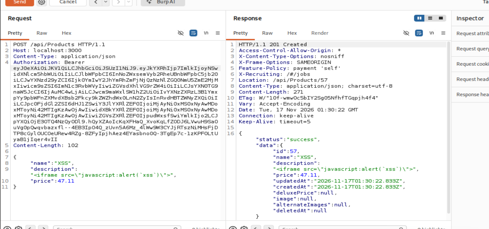
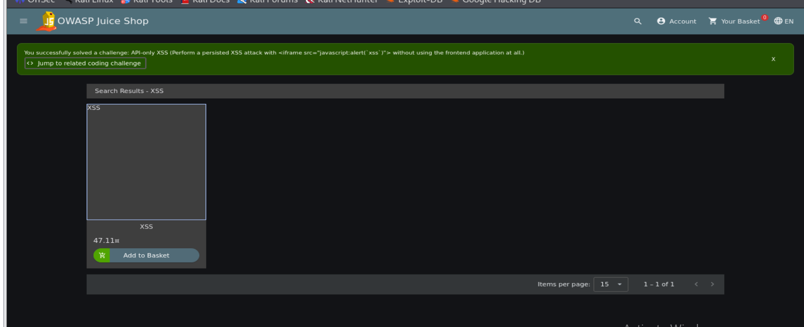
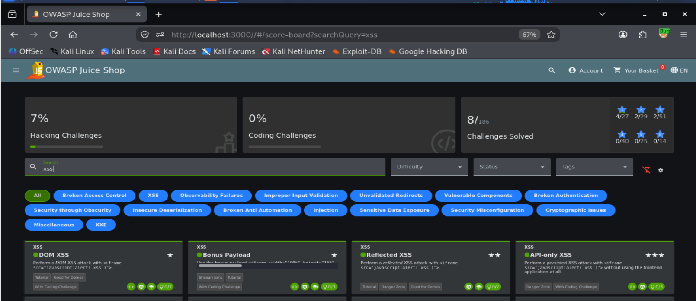

# API-only Cross-Site Scripting (XSS)

## 1. Vulnerability Overview

API-only Cross-Site Scripting (XSS) occurs when an attacker uses an application's API directly to inject malicious content without relying on the frontend application.

In this challenge, a specially crafted HTTP request was sent to the REST API to create a product containing an XSS payload.

The payload was stored in the product description, and the application recognized the successful exploitation through its challenge verification mechanism.

## 2. Lab Environment

- **Application:** OWASP Juice Shop
- **Operating System:** Kali Linux
- **Deployment:** Docker
- **Proxy Tool:** Burp Suite
- **Target:** http://localhost:3000
- **Vulnerability:** API-only XSS
- **API Endpoint:** `/api/Products`

## 3. API Request Analysis

First, Burp Suite was used to inspect HTTP requests between the browser and OWASP Juice Shop.

After examining the available requests, the REST API endpoint responsible for creating products was identified.

The identified endpoint was:

```http
POST /api/Products
```

The request was sent directly through Burp Suite Repeater instead of using the frontend application to create the product.

## 4. Exploitation

### Step 1: Prepare the API Request

A POST request was prepared to create a new product through the REST API.

The following JSON structure was used:

```json
{
  "name": "XSS",
  "description": "<iframe src=\"javascript:alert(`xss`)\">",
  "price": 47.11
}
```

### Step 2: Inject the XSS Payload

The following payload was inserted into the `description` field:

```html
<iframe src="javascript:alert(`xss`)">
```

The request was authenticated using the account's Bearer token.

### Step 3: Send the Request

The prepared request was sent using Burp Suite Repeater.

The server returned the following HTTP response:

```http
HTTP/1.1 201 Created
```

The response confirmed that the product was successfully created.

The newly created product received ID `57`.

**Evidence – API Request and Response**



### Step 4: Verify the Exploitation

After sending the request, the application displayed a success notification confirming that the API-only XSS challenge had been solved.

The newly created product also appeared in the application's search results.

**Evidence – Successful Exploitation**



## 5. Score Board Verification

The OWASP Juice Shop Score Board was accessed to verify the challenge status.

The API-only XSS challenge was displayed with a green status indicator, confirming successful completion.

At the time of verification, the overall progress was:

- **Hacking Challenges:** 7%
- **Challenges Solved:** 8/186
- **API-only XSS:** Solved

**Evidence – Score Board Verification**



## 6. Impact

Successful API-only XSS exploitation may allow an attacker to:

- Inject malicious JavaScript through API endpoints.
- Store malicious content in application data.
- Execute JavaScript when the stored content is rendered.
- Potentially affect users who interact with the vulnerable content.

The actual impact depends on the application's security controls and the context in which the stored content is rendered.

## 7. Remediation

To prevent API-based XSS vulnerabilities:

- Validate and sanitize user-controlled input.
- Apply context-aware output encoding.
- Avoid unsafe HTML rendering.
- Use safe DOM APIs such as `textContent`.
- Implement a restrictive Content Security Policy (CSP).
- Ensure that API-created content is handled securely by the frontend.

## 8. Conclusion

Successfully completed the API-only XSS challenge in OWASP Juice Shop using Burp Suite Repeater.

A malicious product description was submitted directly through the REST API using a POST request.

The server successfully created the product, and the application confirmed that the API-only XSS challenge had been solved.

This exercise demonstrated how vulnerabilities can be exploited through direct API interaction without relying on the frontend application to perform the injection.
