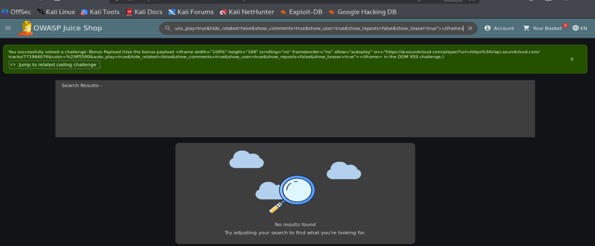
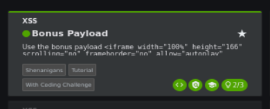

# Bonus Payload — OWASP Juice Shop

## 1. Challenge Information

- **Target:** OWASP Juice Shop
- **Category:** XSS
- **Challenge:** Bonus Payload
- **Status:** Solved

## 2. Objective

Use the provided bonus iframe payload in the DOM XSS challenge to complete the Bonus Payload challenge.

## 3. Exploitation Steps

1. Opened the DOM XSS challenge in OWASP Juice Shop.
2. Used the bonus iframe payload provided by the challenge.
3. Submitted the payload.
4. Verified the result through the application's success notification.

## 4. Result

The application displayed a success notification confirming that the Bonus Payload challenge was successfully solved.

## 5. Security Impact

Unsafe handling of HTML content may allow attackers to inject unexpected HTML elements or embed external content into vulnerable web pages.

The actual impact depends on the vulnerable HTML context and the application's security controls.

## 6. Evidence

### Screenshot 1 — Bonus Payload Execution

### Screenshot 2 — Challenge Solved

