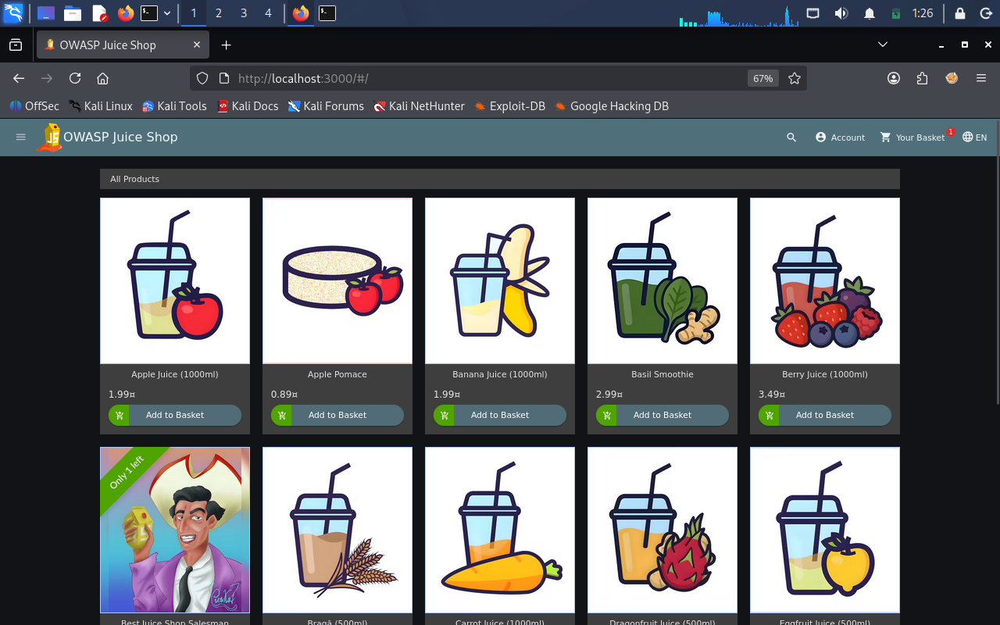
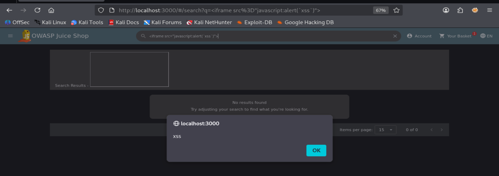

# DOM-Based XSS — OWASP Juice Shop

## 1. Overview

- **Target:** OWASP Juice Shop
- **Vulnerability:** DOM-Based Cross-Site Scripting (XSS)
- **Environment:** Kali Linux
- **Tools:** Firefox, Burp Suite (Optional)
- **Status:** Solved



## 2. Objective

Exploit a DOM-Based XSS vulnerability by injecting a JavaScript payload into the application's search functionality and verify that the injected JavaScript executes in the browser.

## 3. Exploitation

I entered the following payload into the search field:

```html
<iframe src="javascript:alert(`xss`)">
```

After submitting the input, a JavaScript alert appeared in the browser, confirming that the injected payload was successfully executed.



## 4. Verification

To verify the successful exploitation:

1. Opened the Score Board.
2. Located the DOM XSS challenge.
3. Confirmed that the challenge was marked as solved.
4. Verified its status under the XSS category.


## 5. Security Impact

DOM-Based XSS occurs when client-side JavaScript processes untrusted input and inserts it into the page in an unsafe way.

Successful exploitation may allow attackers to execute malicious JavaScript in the victim's browser, potentially leading to:

- Session theft under certain conditions.
- Unauthorized actions performed in the victim's context.
- Manipulation of page content.
- Phishing attacks through injected content.

## 6. Conclusion

The challenge demonstrated how unsafe client-side input handling can lead to DOM-Based Cross-Site Scripting.

It also highlighted the importance of validating untrusted input and using safe DOM manipulation methods to prevent JavaScript injection.
