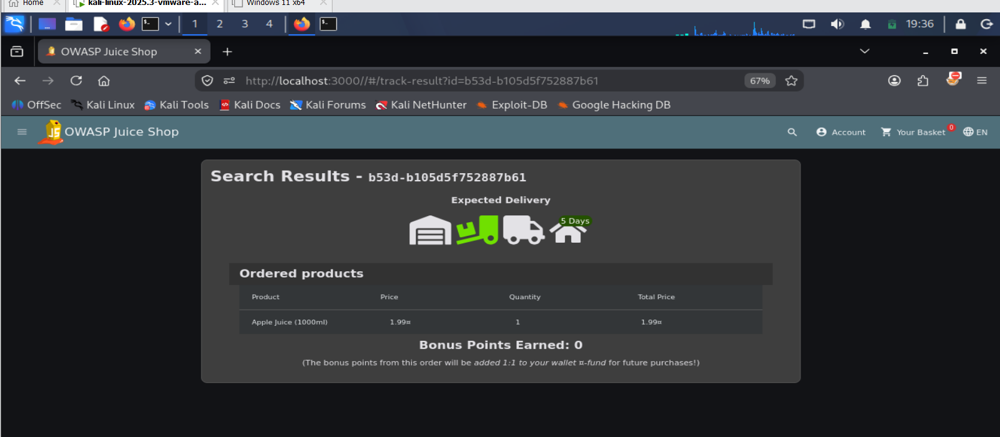
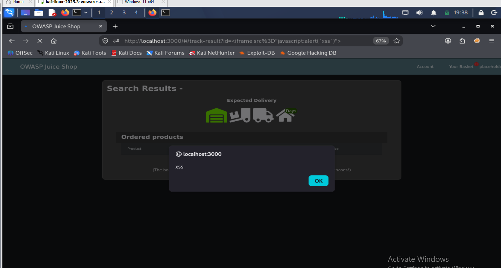
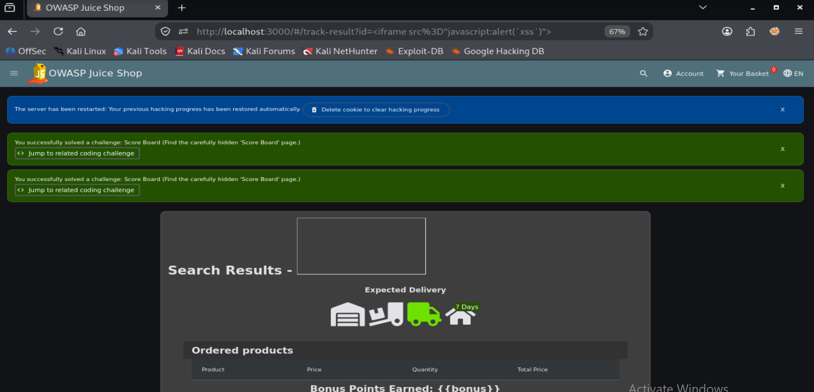
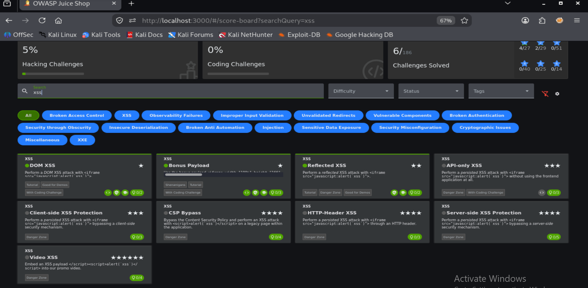

# Reflected Cross-Site Scripting (XSS)

## 1. Vulnerability Overview

Reflected Cross-Site Scripting (XSS) is a web vulnerability that occurs when an application processes user-controlled input and reflects it into a page without proper handling.

An attacker can inject malicious JavaScript code through a URL parameter or another input source. When the vulnerable page processes the input, the browser may execute the injected code.

Unlike Stored XSS, the payload is not permanently stored in the application.

## 2. Lab Environment

- **Application:** OWASP Juice Shop
- **Operating System:** Kali Linux
- **Deployment:** Docker
- **Proxy Tool:** Burp Suite
- **Target:** http://localhost:3000
- **Vulnerability:** Reflected XSS
- **Target Page:** Track Result

## 3. Identifying the Target

First, I accessed the OWASP Juice Shop application and navigated to the shopping basket.

I added a product to the basket and completed the checkout process to create a new order.

After that, I opened the order tracking page to inspect the generated order information.

**Evidence – Order Tracking Page**



## 4. Identifying the Injection Point

The Track Result page contained an `id` parameter in the application URL.

The original URL looked like this:

```text
http://localhost:3000/#/track-result?id=ORDER_ID
```

I identified the `id` parameter as the input point for testing the XSS vulnerability.

## 5. Exploitation

I replaced the original order ID with the following XSS payload:

```html
<iframe src="javascript:alert(`xss`)">
```

The URL-encoded payload was:

```text
%3Ciframe%20src%3D%22javascript:alert(%60xss%60)%22%3E
```

After opening the modified URL, the injected JavaScript code was executed successfully.

A browser alert displaying `xss` appeared on the page.

**Evidence – XSS Payload Execution**



## 6. Verification

After executing the payload, the application displayed success notifications confirming that the challenge had been solved.

I then accessed the Score Board and filtered the challenges by XSS.

The Reflected XSS challenge was displayed with a green status indicator, confirming successful completion.

**Evidence – Successful Verification**



**Evidence – Reflected XSS Challenge Solved**



## 7. Impact

Successful exploitation of Reflected XSS may allow an attacker to:

- Execute JavaScript in a victim's browser.
- Manipulate the content displayed on a web page.
- Perform unauthorized actions within the application's context.
- Access sensitive information exposed to client-side scripts.

The actual impact depends on the application's security controls and the victim's privileges.

## 8. Remediation

To prevent Reflected XSS vulnerabilities:

- Implement context-aware output encoding.
- Validate and sanitize untrusted input.
- Avoid unsafe HTML rendering methods.
- Use safe DOM APIs such as `textContent`.
- Apply a restrictive Content Security Policy (CSP).

## 9. Conclusion

Successfully identified and exploited a Reflected Cross-Site Scripting vulnerability in OWASP Juice Shop.

The vulnerability was tested through the `id` parameter in the Track Result page.

The injected payload successfully executed JavaScript in the browser, and the challenge was confirmed as solved through the application's Score Board.

This exercise demonstrated how improperly handled user-controlled input can lead to JavaScript execution in a victim's browser.
