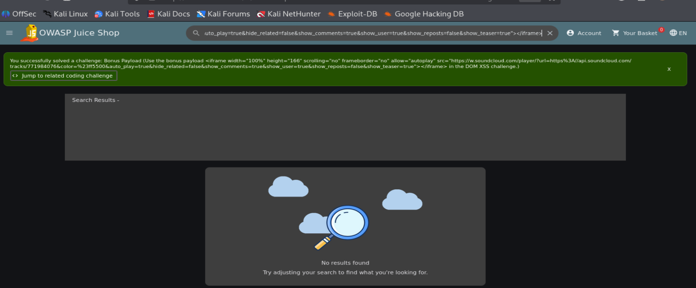
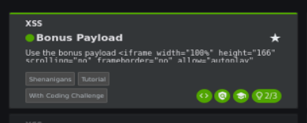

# Bonus Payload — OWASP Juice Shop

**Author:** Sayed Ahmed

## 1. Challenge Information

- **Target:** OWASP Juice Shop
- **Category:** XSS
- **Challenge:** Bonus Payload
- **Status:** Solved

## 2. Objective

Use the provided bonus iframe payload in the DOM XSS challenge.

## 3. Exploitation

1. Opened the DOM XSS challenge.
2. Used the bonus iframe payload provided by the challenge.
3. Submitted the payload and checked the result.

### Screenshot 1 — Bonus Payload Execution

## 4. Result

The application displayed a success notification confirming that the Bonus Payload challenge was solved.

### Screenshot 2 — Challenge Solved

## 5. Impact

An attacker may abuse unsafe handling of HTML content to embed unexpected external content in a vulnerable page.
