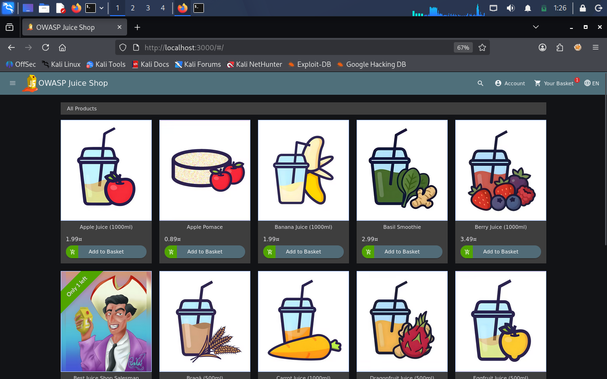
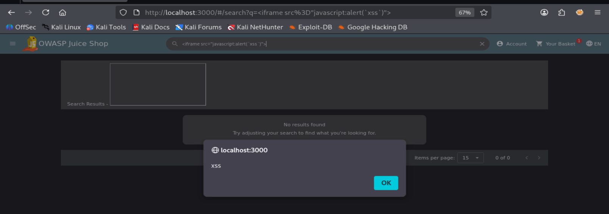

# DOM-Based XSS — OWASP Juice Shop

**Author:** Sayed Ahmed

## 1. Overview

- **Target:** OWASP Juice Shop
- **Vulnerability:** DOM-Based Cross-Site Scripting (XSS)
- **Environment:** Kali Linux
- **Tools:** Firefox, Burp Suite (optional)



## 2. Exploitation

I entered the following payload into the search field:

```html
<iframe src="javascript:alert(`xss`)">
```

After submitting the input, a JavaScript alert appeared in the browser, confirming that the payload was executed.



## 3. Verification

- Opened the Score Board.
- Confirmed that the DOM XSS challenge was marked as solved.
- The challenge appeared under the XSS category.


## 4. Impact

DOM-Based XSS may allow JavaScript execution in a victim's browser in the context of the vulnerable application.

## 5. Remediation

- Avoid unsafe DOM manipulation with untrusted input.
- Use safe DOM APIs and appropriate output encoding.
- Apply a restrictive Content Security Policy (CSP) as an additional security layer.
