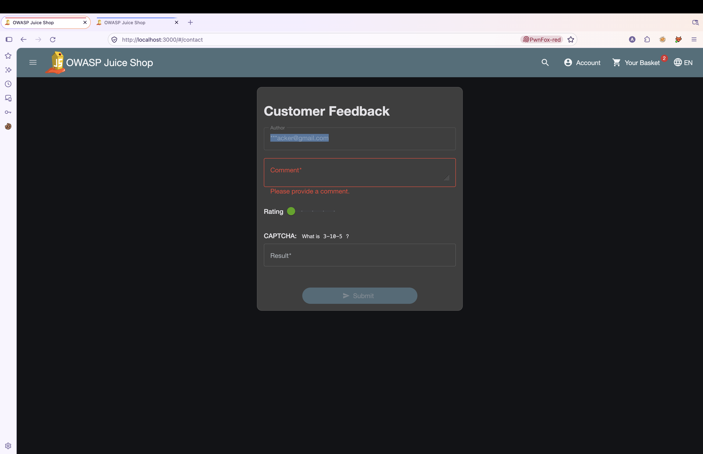
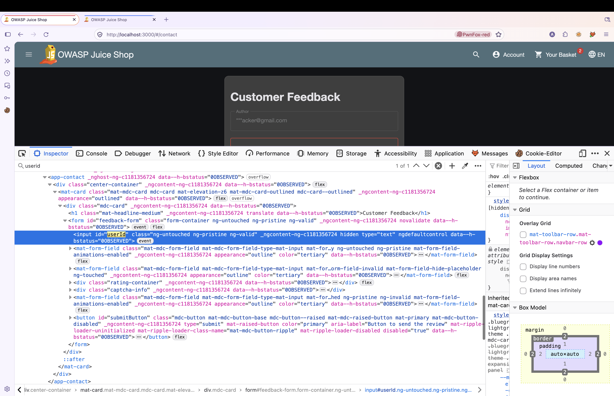
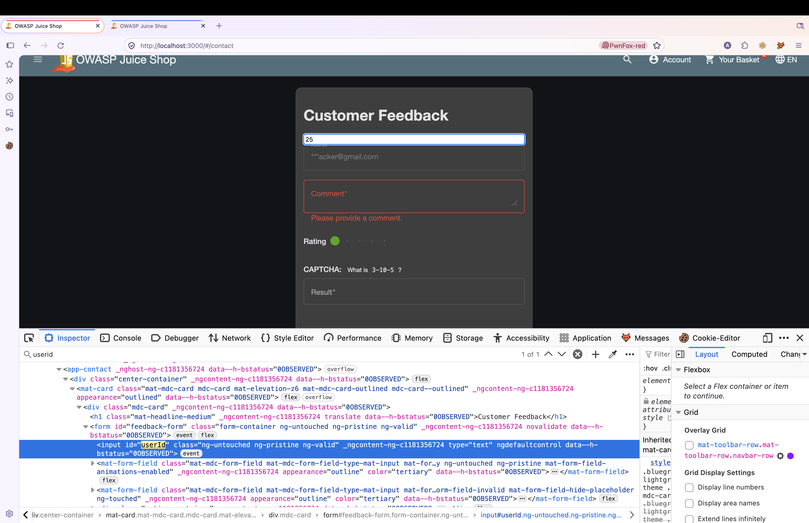
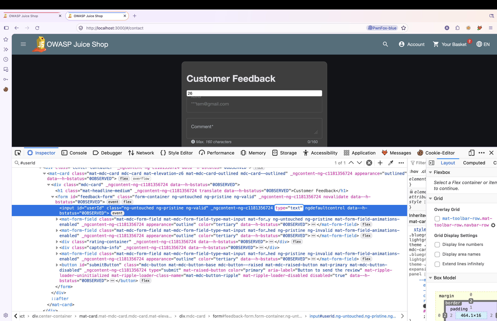
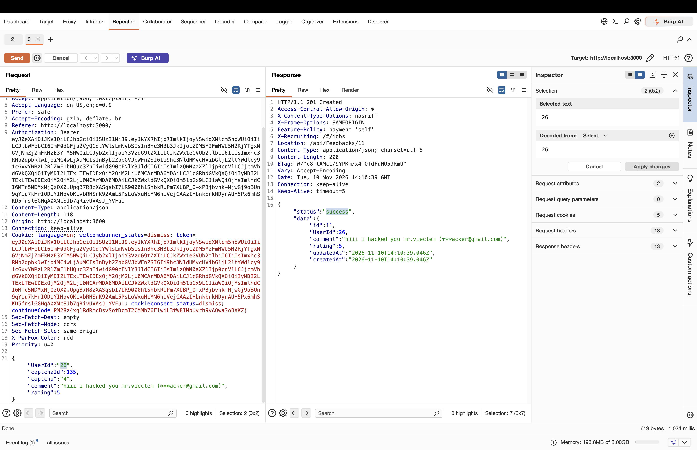
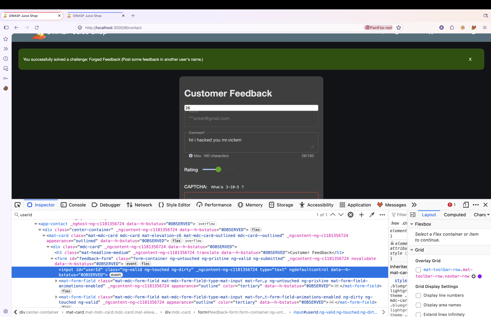
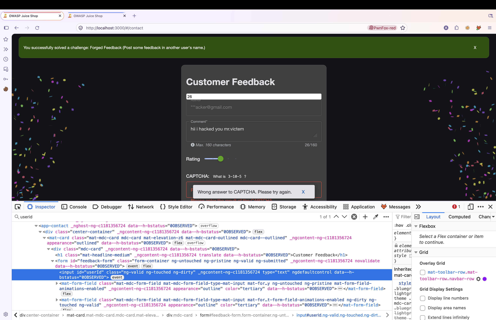

# OWASP Juice Shop – Forged Feedback via Client-Side UserId Tampering (Broken Access Control)

> Tested on a local, intentionally vulnerable training app (OWASP Juice Shop) at `http://localhost:3000`.
> Date: 2026-11-10 | Tools: Burp Suite (Repeater), Firefox + PwnFox

## Summary

The endpoint `POST /api/Feedbacks` accepts a client-supplied `UserId` field in the request body without checking it against the authenticated user's identity (from the session JWT). An authenticated user can post feedback attributed to another user's account just by changing the hidden `userId` form field's value before submitting.

| Field | Value |
|---|---|
| Vulnerability | Forged Feedback (Broken Object Property Level Authorization) |
| Category | OWASP Top 10 – A01:2021 Broken Access Control |
| Endpoint | `POST /api/Feedbacks` |
| Authentication | Required (any valid user) |
| Impact | Integrity (impersonation / forged content attributed to another user) |
| Challenge solved | **Forged Feedback** (Post some feedback in another user's name.) |

## Test Accounts

| Role | Email | User ID | Feedback ID | Feedback content |
|---|---|---|---|---|
| Attacker | ***acker@gmail.com (masked, full address not specified) | 25 | Not specified | Not specified |
| Victim | Not specified | 26 | 11 | "hiii i hacked you mr.victem (***acker@gmail.com)" |

## Steps to Reproduce

### 1. Baseline – locate the hidden `userId` field

On the Customer Feedback page (`/#/contact`), the form's "Author" field is pre-filled with the logged-in user's masked email, and a hidden `<input id="userId">` carries the account's own user ID (`25`) that will be attached to the feedback on submit.




### 2. Expose the hidden field's value

Using the browser DevTools Inspector, the `hidden` attribute/display styling on `#userId` is removed, revealing its current value, `25` — the attacker's own account ID.



### 3. Tamper with the UserId value

The now-visible `userId` input is edited directly in the browser to `26`, the victim's user ID.



### 4. Submit the forged feedback request

With the comment "hii i hacked you mr.victem" and the tampered `UserId`, the form is submitted. The request below (captured/replayed in Burp Repeater) shows the full body sent to the server:

```http
POST /api/Feedbacks HTTP/1.1
Host: localhost:3000
Authorization: Bearer <attacker_jwt>
Content-Type: application/json
Cookie: token=<attacker_jwt>

{
  "UserId": "26",
  "captchaId": 135,
  "captcha": "4",
  "comment": "hiii i hacked you mr.viectem (***acker@gmail.com)",
  "rating": 5
}
```

The server accepts the attacker-supplied `UserId` as-is and creates the feedback record under the victim's account instead of the authenticated attacker's own account:



Relevant part of the response:

```json
{
  "status": "success",
  "data": {
    "id": 11,
    "UserId": 26,
    "comment": "hiii i hacked you mr.victem (***acker@gmail.com)",
    "rating": 5
  }
}
```

### 5. Result

The application confirms the forged submission with a `201 Created` response (`Location: /api/Feedbacks/11`) and the app flags the challenge as solved: "You successfully solved a challenge: Forged Feedback (Post some feedback in another user's name.)"




## Root Cause

The client sends a `UserId` property directly inside the `POST /api/Feedbacks` request body, and the server persists it without validating it against the user ID embedded in the caller's own authenticated JWT. The "Author" text shown in the UI is tied to the logged-in session, but the actual ownership of the created resource (`UserId`) is taken verbatim from client input — a mass-assignment / broken object property level authorization flaw. Trusting a hidden form field for an authorization-sensitive value is not a substitute for a server-side identity check.

## Impact

Any authenticated user can create feedback entries attributed to an arbitrary victim's `UserId` by guessing or enumerating IDs, without the victim's knowledge or consent. This allows impersonation, reputation damage, and potential defamation/social-engineering via content that appears to originate from the victim. No confidentiality or availability impact was observed; the impact is limited to data integrity (forged ownership of a resource).

## Remediation

- Derive `UserId` for new feedback strictly from the authenticated session/JWT subject on the server; never from a client-supplied field.
- Remove the hidden `userId` input from the form, or make it non-authoritative — the backend must ignore it.
- Add object-level/property-level authorization checks on write endpoints so a user cannot set ownership fields to another user's ID.
- Use an explicit allow-list (DTO/schema) for fields accepted on `POST /api/Feedbacks` to prevent mass assignment of sensitive properties.

## References

- OWASP Top 10 – A01:2021 Broken Access Control
- OWASP API Security Top 10 – API3:2023 Broken Object Property Level Authorization
- https://owasp.org/www-project-juice-shop/

## Disclaimer

For educational purposes only, performed on a local lab environment.
