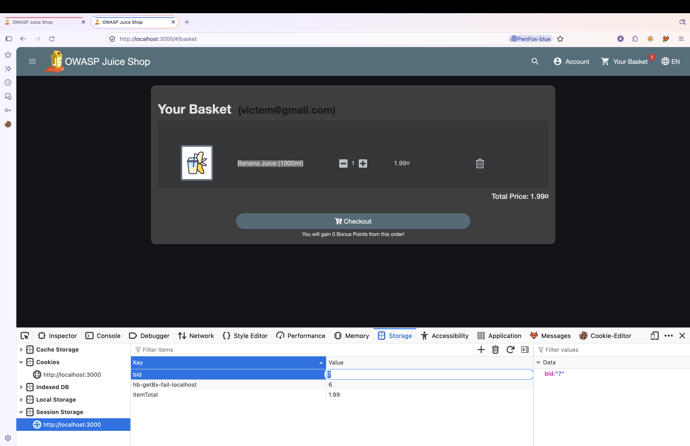
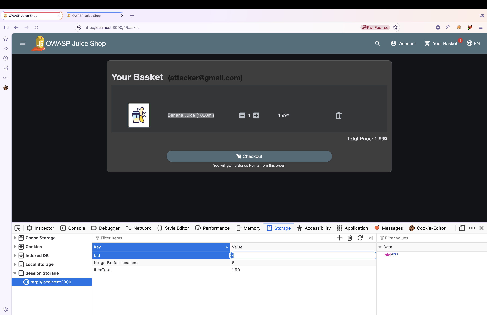

# OWASP Juice Shop – View Another User's Basket (Insecure Direct Object Reference / Broken Access Control)

> Tested on a local, intentionally vulnerable training app (OWASP Juice Shop) at `http://localhost:3000`.
> Date: 2026-11-10 | Tools: Firefox + PwnFox, Firefox DevTools (Storage tab)

## Summary

The basket page loads the basket identified by the `bid` value kept in the browser's Session Storage (`bid`), and the application does not appear to check that this basket belongs to the logged-in user. An authenticated user can read another user's basket just by changing the `bid` value from their own basket ID to the victim's basket ID. The only value changed during the test was the `bid` (basket ID); nothing else was modified.

| Field | Value |
|---|---|
| Vulnerability | Insecure Direct Object Reference (IDOR) |
| Category | OWASP Top 10 – A01:2021 Broken Access Control |
| Endpoint | Not specified (the HTTP request was not captured in the screenshots; the page is `http://localhost:3000/#/basket`) |
| Authentication | Required (any valid user) |
| Impact | Confidentiality (an attacker can view another user's basket contents) |
| Challenge solved | Not specified (no challenge banner appears in the screenshots) |

## Test Accounts

| Role | Email | User ID | Basket ID | Basket content |
|---|---|---|---|---|
| Attacker | attacker@gmail.com | Not specified | 6 | Apple Juice (1000ml) x1 |
| Victim | victem@gmail.com | Not specified | 7 | Banana Juice (1000ml) x1 |

## Steps to Reproduce

### 1. Attacker's own basket

Logged in as `attacker@gmail.com` (red PwnFox tab). The basket contains **Apple Juice (1000ml)** and Session Storage holds `bid = 6`.


### 2. Victim's basket

In a second session (blue PwnFox tab), logged in as `victem@gmail.com`. The basket contains **Banana Juice (1000ml)** and Session Storage holds `bid = 7`.



### 3. Identify the client-controlled basket ID

Both screenshots show that the basket the page displays is tied to the `bid` key in Session Storage, which the user can edit freely. The attacker's `bid` is 6 and the victim's is 7.

### 4. Exploit: change only the `bid`

In the attacker's session, the `bid` value in Session Storage was changed from `6` to `7` (the victim's basket ID). No other value (account, token, or header) was changed. The HTTP request and response behind this action were not captured in the screenshots, so they are Not specified:

```http
Not specified
```

After the change, the page, still logged in as `attacker@gmail.com`, shows the victim's **Banana Juice (1000ml)** instead of the attacker's Apple Juice. This proves the basket is returned based on the `bid` supplied by the client, without an ownership check:



Relevant part of the response:

```json
Not specified
```

### 5. Result

The attacker account (`attacker@gmail.com`) is able to view the contents of the victim's basket (`bid = 7`) by changing only the basket ID. This confirms an IDOR on the basket object.

## Root Cause

The application appears to trust the client-supplied basket ID (`bid`) and does not verify that the requested basket belongs to the authenticated user. This is inferred from the behavior in the screenshots, since the underlying request was not captured.

## Impact

Any authenticated user can read the baskets of other users by changing the basket ID. Because basket IDs look sequential and predictable (6, 7), an attacker could enumerate them and view the contents of many users' baskets.

## Remediation

- Enforce object-level authorization on the server: verify that the requested basket belongs to the authenticated user on every request.
- Do not rely on a client-controlled value (such as Session Storage `bid`) to decide which basket is returned; derive it from the authenticated session or token.
- Use unpredictable identifiers (UUIDs) instead of sequential integers.
- Add automated tests for access control on all object-level endpoints.

## References

- OWASP Top 10 – A01:2021 Broken Access Control
- OWASP API Security Top 10 – API1:2023 Broken Object Level Authorization
- OWASP Juice Shop – https://owasp-juice.shop

## Disclaimer

For educational purposes only, performed on a local lab environment.
