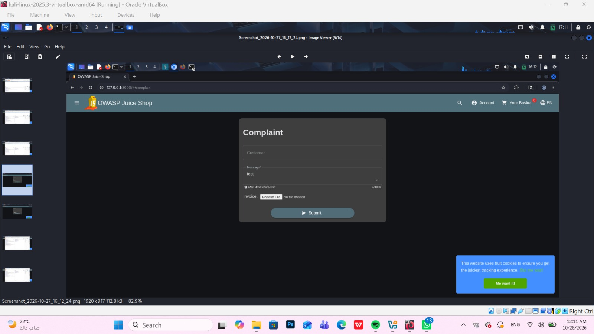
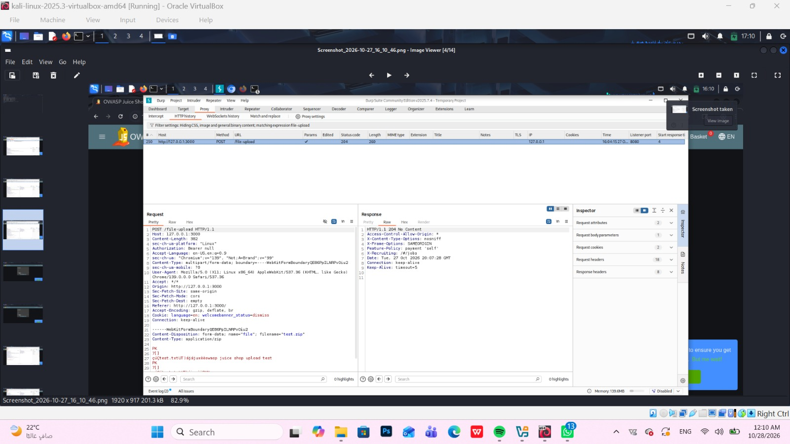
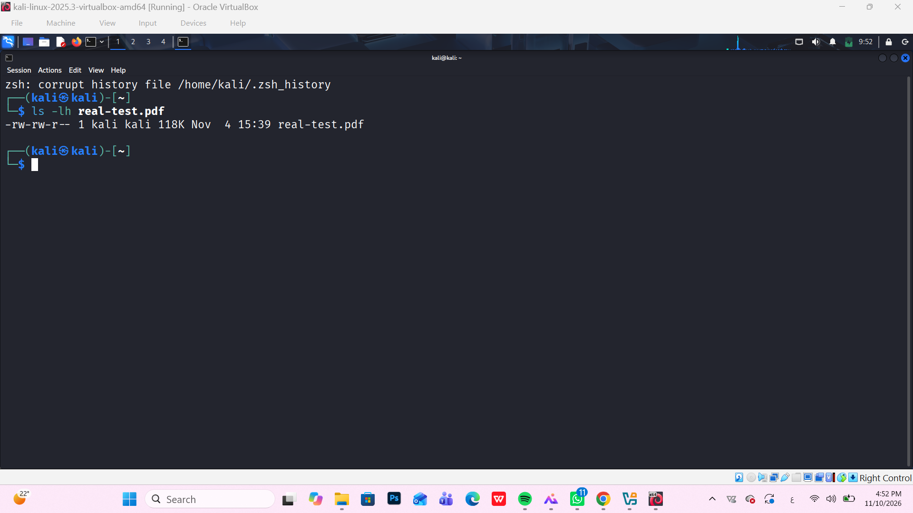
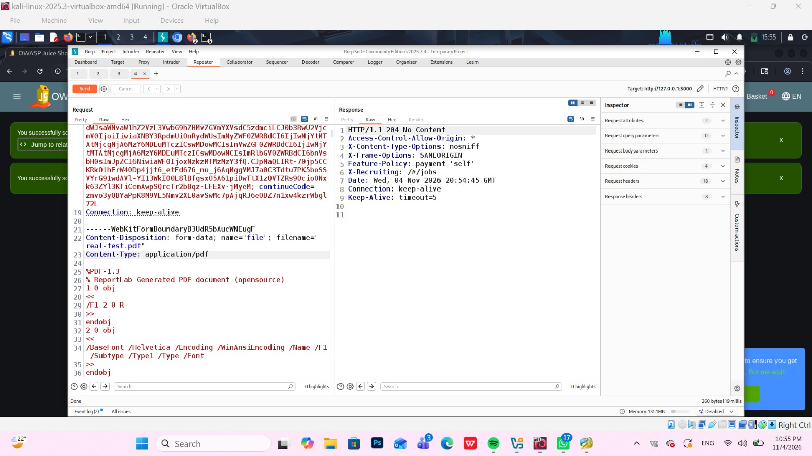
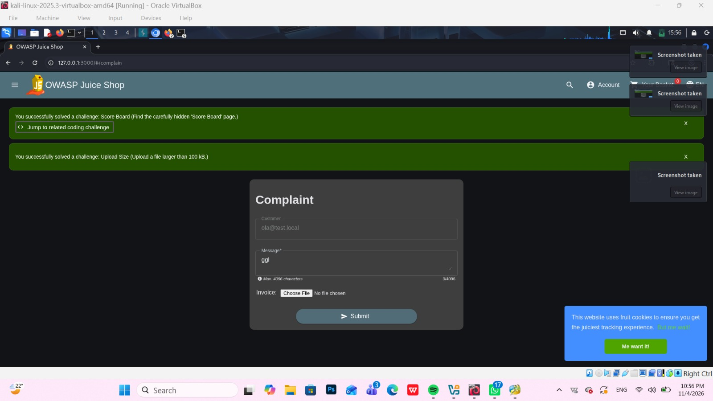

# OWASP Juice Shop – File Upload Size Handling (Upload Size Challenge)

> Tested on a local, intentionally vulnerable training app (OWASP Juice Shop) at `http://127.0.0.1:3000`.
> Date: 2026-11-10 | Tools: Burp Suite Community Edition (Repeater), Kali Linux, Firefox

## Summary

The `POST /file-upload` request accepted a PDF file named `real-test.pdf` with a reported local file size of 118 KB and returned `HTTP/1.1 204 No Content`. The application then displayed the success message for the **Upload Size** challenge, whose description is “Upload a file larger than 100 KB.” The evidence confirms that the challenge condition was met in the local lab. It does **not**, by itself, demonstrate unrestricted file upload, public file retrieval, execution of uploaded content, or another security impact. Therefore, this is documented as observed upload behavior / challenge evidence, not as a confirmed exploitable vulnerability.

| Field | Value |
|---|---|
| Vulnerability | Not confirmed – File Upload Size Handling |
| Category | Not assigned – current evidence does not establish an OWASP vulnerability category |
| Endpoint | `POST /file-upload` |
| Authentication | Not specified in the supplied evidence |
| Impact | No security impact established; the evidence shows acceptance of a file larger than 100 KB and challenge completion |
| Challenge solved | **Upload Size** (Upload a file larger than 100 KB.) |

## Test Accounts

| Role | Email | User ID | Resource ID | Resource content |
|---|---|---|---|---|
| Tester | Not specified | Not specified | Not specified | Not specified |
| Other user | Not specified | Not specified | Not specified | Not specified |

## Steps to Reproduce

### 1. Open the complaint upload form

The local OWASP Juice Shop complaint page contains an Invoice file input. The supplied screenshot shows the form before the PDF upload test.



### 2. Capture the normal upload request

The supplied Burp screenshot shows a `POST /file-upload` request using multipart form-data with `filename="test.zip"` and `Content-Type: application/zip`. The displayed request `Content-Length` is 382 bytes, and the response is `HTTP/1.1 204 No Content`. This is recorded as the normal/baseline upload request. The screenshot does not show a rejection or a security-control bypass.



### 3. Confirm the larger test file exists

The Kali terminal shows `real-test.pdf` in the home directory with a displayed size of 118K. The exact byte count and PDF contents are not established by this screenshot.



### 4. Inspect the larger PDF upload request in Burp Suite

The captured request is `POST /file-upload`. Its multipart form-data includes `filename="real-test.pdf"` and `Content-Type: application/pdf`. The response shown is `HTTP/1.1 204 No Content`.



Relevant response:

```http
HTTP/1.1 204 No Content
```

### 5. Verify the challenge result

The application displays the success message: `You successfully solved a challenge: Upload Size (Upload a file larger than 100 KB.)`.



### 6. Result

The observed upload request received a `204 No Content` response, and the application displayed the Upload Size challenge completion message. This confirms the challenge was solved in the local lab. It does not prove that the uploaded file is publicly accessible, executable, or handled insecurely in another way.

## Root Cause

Not established. The evidence shows the application accepted a file larger than the challenge's 100 KB threshold, but it does not show the server-side validation logic or establish a security-control failure.

## Impact

No exploitable security impact can be concluded from the supplied evidence alone. The demonstrated result is limited to successful completion of the Upload Size training challenge. Further testing would be required to determine whether file type validation, storage permissions, filename handling, content serving, or access controls are insecure.

## Remediation

These are general defensive controls for file-upload functionality; they are not proof that the tested application lacks them:

- Enforce an explicit server-side maximum file size appropriate to the business requirement.
- Validate file type using file signatures/content inspection in addition to the client-provided MIME type and extension.
- Generate server-side filenames and prevent user-controlled paths from affecting storage locations.
- Store uploads outside the web root or in private object storage, and prevent execution of uploaded files.
- Apply authorization checks to upload and download operations, and serve files with safe content-disposition and content-type headers.
- Scan files where appropriate and log upload decisions without exposing sensitive data.

## References

- OWASP Cheat Sheet Series – File Upload Cheat Sheet: https://cheatsheetseries.owasp.org/cheatsheets/File_Upload_Cheat_Sheet.html
- OWASP Juice Shop: https://owasp.org/www-project-juice-shop/

## Disclaimer

For educational purposes only, performed on a local lab environment.
