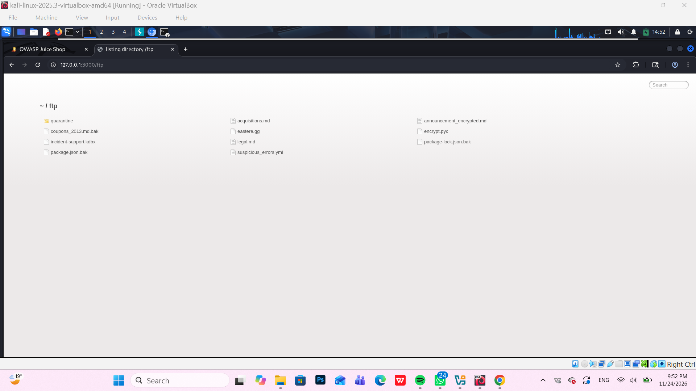
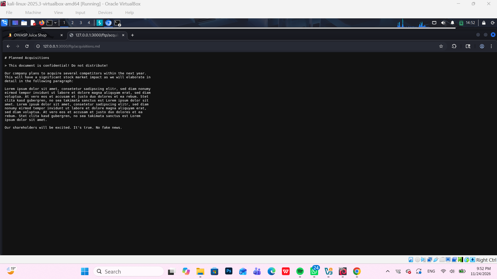
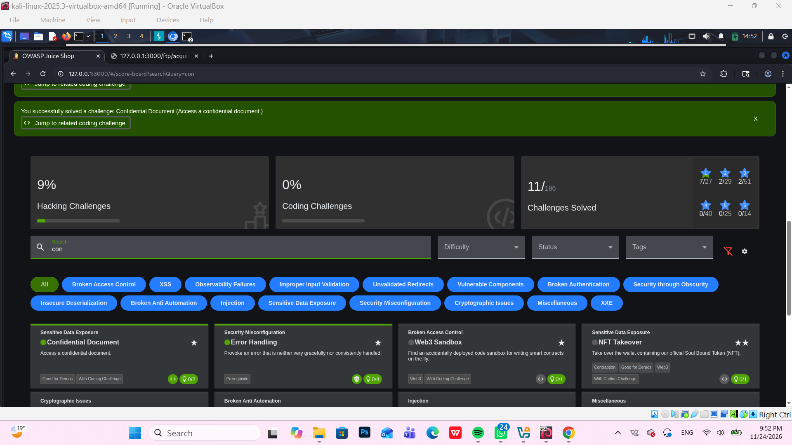

# OWASP Juice Shop – Confidential Document Exposed via /ftp Directory Listing (Sensitive Data Exposure / Security Misconfiguration)

> Tested on a local, intentionally vulnerable training app (OWASP Juice Shop) at `http://127.0.0.1:3000`.
> Date: 2026-11-24 | Tools: Chromium-based browser on Kali Linux (VirtualBox VM)

## Summary

The endpoint `GET /ftp` exposes a browsable directory listing of the server's internal files, and `GET /ftp/{filename}` serves any listed file without checking whether the requester is allowed to see it. Anyone who can reach the application can read the confidential document `acquisitions.md` just by browsing to `/ftp` and clicking the file.

| Field | Value |
|---|---|
| Vulnerability | Sensitive Data Exposure via Directory Listing (CWE-548, CWE-200) |
| Category | OWASP Top 10 – A05:2021 Security Misconfiguration |
| Endpoint | `GET /ftp/{filename}` |
| Authentication | None (no authentication shown in the screenshots) |
| Impact | Confidentiality – unauthorized read of an internal confidential document |
| Challenge solved | **Confidential Document** (Access a confidential document.) |

## Test Accounts

| Role | Email | User ID | File ID | File content |
|---|---|---|---|---|
| Attacker | Not specified (no login shown) | Not specified | `acquisitions.md` | Planned acquisitions notice marked "confidential" |
| Victim | Not applicable | Not applicable | Not applicable | Not applicable |

## Steps to Reproduce

### 1. Browse to the /ftp directory

Open `http://127.0.0.1:3000/ftp` in the browser. The server returns a directory listing titled `~ / ftp` that shows the folder `quarantine` and the files `acquisitions.md`, `announcement_encrypted.md`, `coupons_2013.md.bak`, `eastere.gg`, `encrypt.pyc`, `incident-support.kdbx`, `legal.md`, `package-lock.json.bak`, `package.json.bak` and `suspicious_errors.yml`.



### 2. Open the confidential file

Click `acquisitions.md` in the listing (or browse directly to its URL):

```http
GET /ftp/acquisitions.md HTTP/1.1
Host: 127.0.0.1:3000
```

The server returns the full file content with no access check, and the file itself says it is confidential:



Relevant part of the response:

```text
# Planned Acquisitions

> This document is confidential! Do not distribute!

Our company plans to acquire several competitors within the next year.
This will have a significant stock market impact as we will elaborate in
detail in the following paragraph:
...
```

### 3. Result

Juice Shop confirms the issue with the banner "You successfully solved a challenge: Confidential Document (Access a confidential document.)", and the Score Board shows the challenge as solved.



## Root Cause

The `/ftp` folder is exposed through the web server with directory listing enabled and without any authentication or authorization check. Internal and confidential files, backups and key files are stored in a web-accessible path, so any visitor can list and download them.

## Impact

Any unauthenticated user who can reach the application can enumerate and download every file in `/ftp`, including confidential business documents (planned acquisitions, which could affect the stock market), backup files (`.bak`) and a KeePass database (`incident-support.kdbx`). This leads to disclosure of confidential business information and can help an attacker with further attacks.

## Remediation

- Disable directory listing on the web server and application.
- Do not store confidential or internal files under a web-accessible path.
- Require authentication and authorization before serving any internal file.
- Remove backup, test and unused files from production deployments.

## References

- OWASP Top 10 – A05:2021 Security Misconfiguration
- OWASP API Security Top 10 – API8:2023 Security Misconfiguration
- OWASP Juice Shop – https://owasp.org/www-project-juice-shop/

## Disclaimer

For educational purposes only, performed on a local lab environment.
