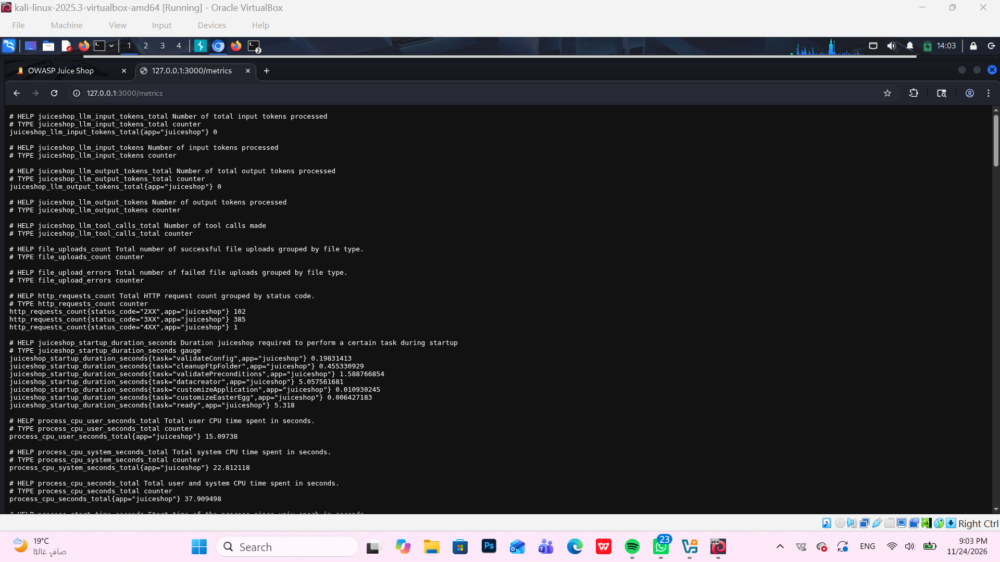

# OWASP Juice Shop – Exposed Metrics (Security Misconfiguration)

> Tested on a local, intentionally vulnerable training app (OWASP Juice Shop) at `http://127.0.0.1:3000`.
> Date: 2026-11-24 | Tools: Firefox (Kali Linux) + OWASP Juice Shop Score Board

## Summary

The endpoint `GET /metrics` serves application and process metrics in a Prometheus-style text format. The supplied screenshots show that the endpoint can be opened in the browser and returns operational data, and that the Juice Shop **Exposed Metrics** challenge was successfully solved. The screenshots do not establish whether the request was made without an authenticated session, so authentication requirements are not confirmed.

| Field | Value |
|---|---|
| Vulnerability | Exposed Metrics |
| Category | OWASP Top 10 – A05:2021 Security Misconfiguration |
| Endpoint | `GET /metrics` |
| Authentication | Not specified (the screenshots do not establish the browser's authentication state) |
| Impact | Confidentiality – disclosure of application and process operational metrics |
| Challenge solved | **Exposed Metrics** (Find the endpoint that serves usage data to be scraped by a popular monitoring system.) |

## Test Accounts

| Role | Email | User ID | Resource ID | Resource content |
|---|---|---|---|---|
| Attacker / tester | Not specified | Not specified | Not applicable | Not specified |
| Victim | Not applicable | Not applicable | Not applicable | Not applicable |

## Steps to Reproduce

### 1. Open the local Juice Shop instance

Open the local training application in the browser at `http://127.0.0.1:3000`.


### 2. Request the metrics endpoint

Navigate to `http://127.0.0.1:3000/metrics`.

The browser displays metrics in a Prometheus-style text format.



### 3. Inspect the exposed metrics

The response includes operational information such as HTTP request counts, startup task durations, and process CPU time. Examples visible in the screenshot include:

- `http_requests_count` grouped by HTTP status code.
- `juiceshop_startup_duration_seconds` grouped by startup task.
- `process_cpu_user_seconds_total`.
- `process_cpu_system_seconds_total`.
- `process_cpu_seconds_total`.

### 4. Exploit step

The endpoint observed in the browser is:

```http
GET /metrics HTTP/1.1
Host: 127.0.0.1:3000
```

No authorization header is shown in the supplied evidence. However, because the screenshot does not establish whether the browser had an authenticated Juice Shop session, unauthenticated access is **not confirmed** by this evidence alone.

### 5. Result

The `/metrics` page returns application metrics, and the Score Board displays the successful challenge message:

`You successfully solved a challenge: Exposed Metrics (Find the endpoint that serves usage data to be scraped by a popular monitoring system.)`


Relevant response excerpt visible in the screenshot:

```text
http_requests_count{status_code="2XX",app="juiceshop"} 102
http_requests_count{status_code="3XX",app="juiceshop"} 385
http_requests_count{status_code="4XX",app="juiceshop"} 1

juiceshop_startup_duration_seconds{task="validateConfig",app="juiceshop"} 0.19831413
juiceshop_startup_duration_seconds{task="cleanupTempFolder",app="juiceshop"} 0.455330929
juiceshop_startup_duration_seconds{task="validatePreconditions",app="juiceshop"} 1.588766854
juiceshop_startup_duration_seconds{task="dataCreator",app="juiceshop"} 5.057561681

process_cpu_user_seconds_total{app="juiceshop"} 15.09738
process_cpu_system_seconds_total{app="juiceshop"} 22.812118
process_cpu_seconds_total{app="juiceshop"} 37.909498
```

## Root Cause

The application exposes a metrics endpoint that returns operational telemetry. The screenshots demonstrate that the endpoint is reachable from the browser, but they do not show the server-side route configuration or access-control policy. The precise configuration weakness therefore requires confirmation from the application configuration.

## Impact

If the metrics endpoint is accessible to unauthorized users, it may disclose operational details such as request volumes, response status distributions, startup-task timing, and process CPU usage. This information can help an attacker understand application behavior and support further reconnaissance. The screenshots do not demonstrate direct access to customer records, credentials, or other user data.

## Remediation

- Restrict the metrics endpoint to trusted monitoring systems or an internal network.
- Require appropriate authentication and authorization where network isolation alone is insufficient.
- Avoid exposing detailed operational metrics on publicly reachable application interfaces.
- Review metric labels and values to ensure they do not disclose secrets or sensitive internal information.

## References

- OWASP Top 10 – A05:2021 Security Misconfiguration
- OWASP API Security Top 10 – API8:2023 Security Misconfiguration
- OWASP Juice Shop – https://owasp.org/www-project-juice-shop/

## Disclaimer

For educational purposes only, performed on a local lab environment.
