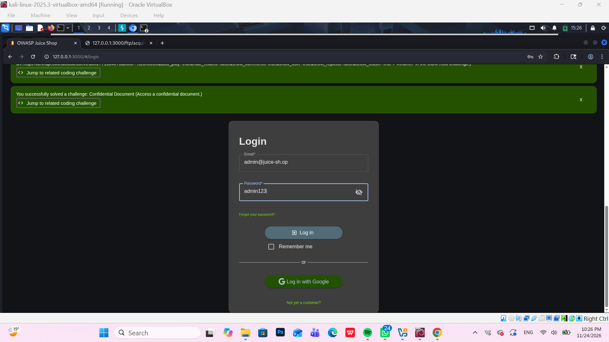
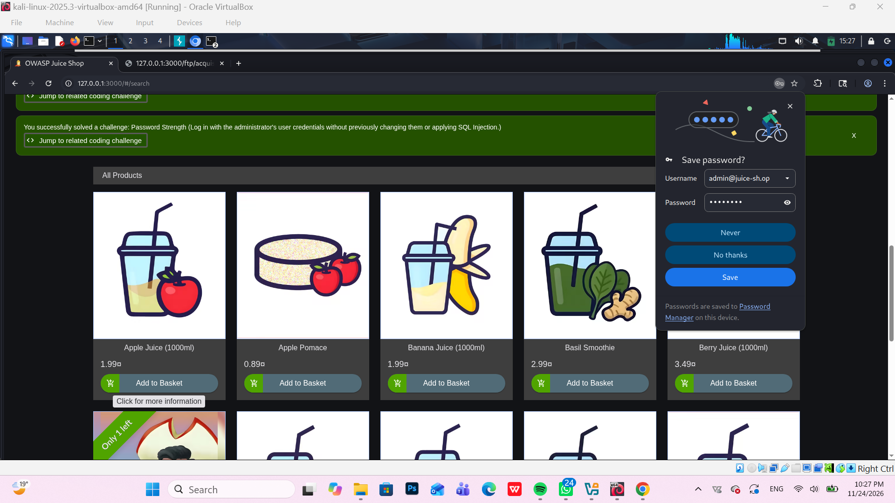

# OWASP Juice Shop – Administrator Account Protected by a Weak Password (Weak Password / Broken Authentication)

> Tested on a local, intentionally vulnerable training app (OWASP Juice Shop) at `http://127.0.0.1:3000`.
> Date: 2026-11-24 | Tools: Chromium-based browser on Kali Linux (VirtualBox VM)

## Summary

The login form at `/#/login` accepts a short, easily guessable password for the administrator account `admin@juice-sh.op`, and the application does not enforce a strong password, rate limiting or lockout. An unauthenticated attacker can log in as the administrator just by guessing the password, with no SQL injection or other bypass needed.

| Field | Value |
|---|---|
| Vulnerability | Weak Password / Easily Guessable Administrator Credentials (CWE-521, CWE-1392) |
| Category | OWASP Top 10 – A07:2021 Identification and Authentication Failures |
| Endpoint | `/#/login` (login form; underlying API request not shown in screenshots) |
| Authentication | None (attacker is unauthenticated before login) |
| Impact | Confidentiality, integrity and availability – full takeover of the administrator account |
| Challenge solved | **Password Strength** (Log in with the administrator's user credentials without previously changing them or applying SQL Injection.) |

## Test Accounts

| Role | Email | User ID | Password | Notes |
|---|---|---|---|---|
| Attacker | None (unauthenticated) | Not applicable | Not applicable | Guesses the administrator password through the login form |
| Victim | `admin@juice-sh.op` | Not specified | `<redacted>` | Administrator account, password not changed from its original value |

## Steps to Reproduce

### 1. Open the login page and enter the administrator credentials

Browse to `http://127.0.0.1:3000/#/login`. Enter the administrator email `admin@juice-sh.op` and a guessed weak password, then click **Log in**.

### 2. Log in successfully

The login succeeds with the guessed password and the application redirects to the product page (`/#/search`) as the administrator. The browser even offers to save the credentials for `admin@juice-sh.op`, which confirms the login was accepted.

### 3. Result

Juice Shop confirms the issue with the banner "You successfully solved a challenge: Password Strength (Log in with the administrator's user credentials without previously changing them or applying SQL Injection.)".

## Root Cause

The administrator account uses a weak, guessable password that was never changed, and the application does not enforce any password strength policy or protect the login against guessing (no rate limiting, lockout or MFA shown).

## Impact

Anyone who can reach the login page can guess the administrator password and take over the administrator account. With administrator access an attacker can read and modify application data and users, and disrupt the service.

## Remediation

- Enforce a strong password policy and force a password change for default or initial administrator credentials.
- Add rate limiting, account lockout or CAPTCHA to the login endpoint.
- Require multi-factor authentication for administrator accounts.
- Block commonly used and breached passwords (for example, with a deny-list).

## References

- OWASP Top 10 – A07:2021 Identification and Authentication Failures
- OWASP API Security Top 10 – API2:2023 Broken Authentication
- OWASP Juice Shop – https://owasp.org/www-project-juice-shop/

## Disclaimer

For educational purposes only, performed on a local lab environment.
